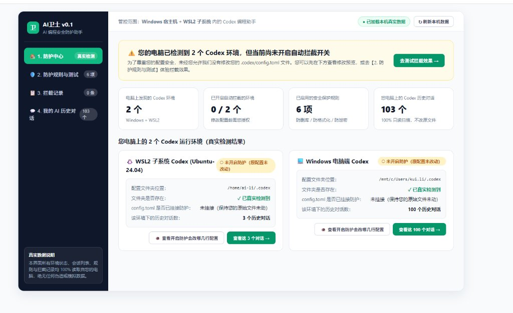
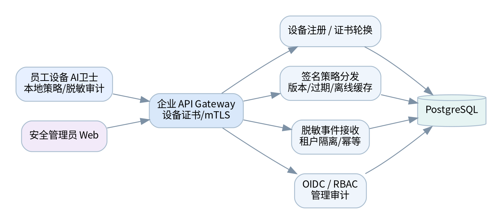
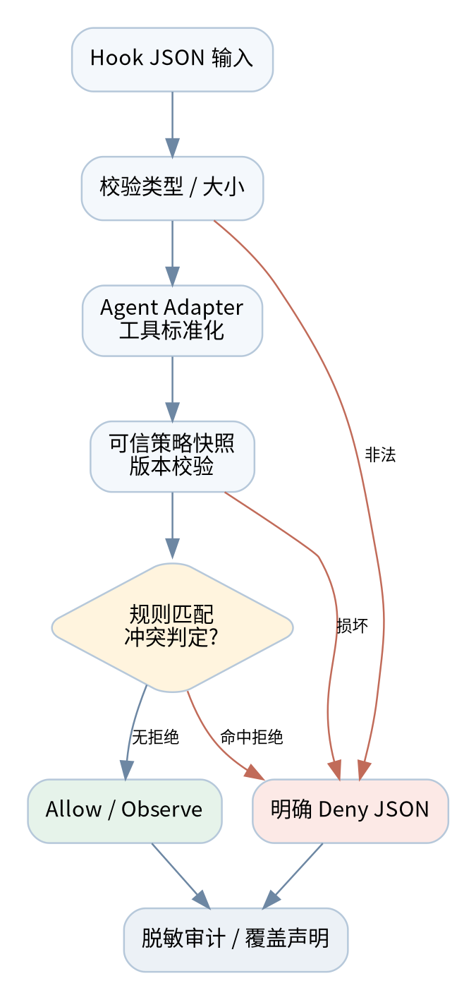
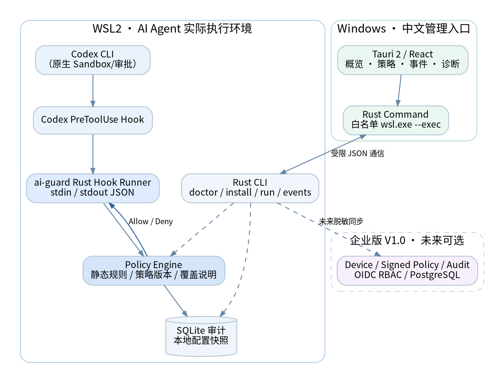
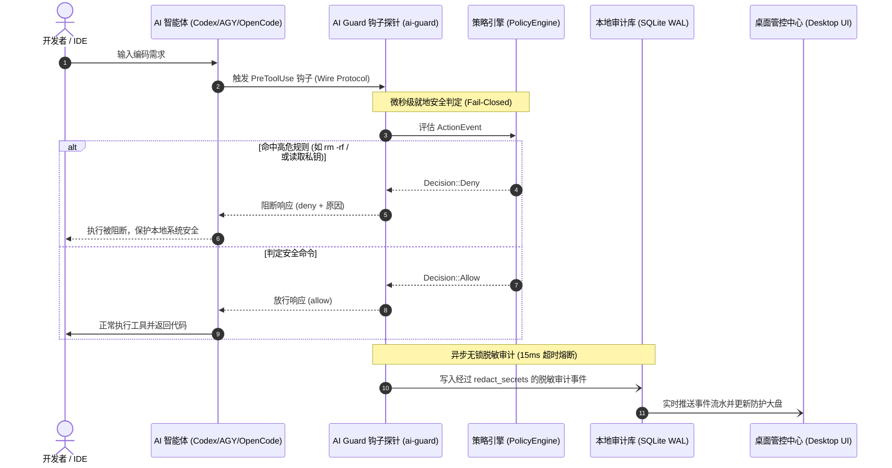
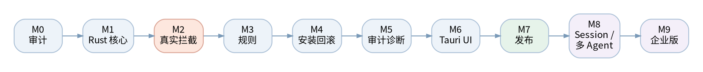

# AI卫士（AI Guard）— 本地 AI 编程安全防火墙与多智能体协同治理中心

<div align="center">


**AI卫士（AI Guard）** 是一款面向个人开发者与研发团队的本地中心化 AI 编程执行前安全防火墙、隐私二次脱敏审计、会话只读保护及多智能体（Multi-Agent）统一治理系统。

运行于 **Windows 宿主机**，无缝纳管 **OpenAI Codex**（Windows 宿主机 Desktop / CLI 与 WSL2 子系统 CLI）、**Google Antigravity（AGY）& agy CLI**、**OpenCode** 及未来 **Claude Code** 等多种 AI 编程智能体。

</div>

---

## 目录

- [一、相关界面与控制中心展示](#一相关界面与控制中心展示)
- [二、多智能体（Multi-Agent）全链路统一治理](#二多智能体multi-agent全链路统一治理)
- [三、会话资产中心：严格只读索引与 SHA-256 事务备份恢复](#三会话资产中心严格只读索引与-sha-256-事务备份恢复)
- [四、不同智能体间的跨生态无损会话迁移](#四不同智能体间的跨生态无损会话迁移)
- [五、核心安全防护引擎（执行前毫秒级强拦截）](#五核心安全防护引擎执行前毫秒级强拦截)
- [六、系统架构全景与执行时序](#六系统架构全景与执行时序)
- [七、快速开始与 CLI 核心命令指南](#七快速开始与-cli-核心命令指南)
- [八、产品演进路线图（Roadmap）](#八产品演进路线图roadmap)
- [九、安全声明、隐私承诺与开源合规](#九安全声明隐私承诺与开源合规)

---

## 一、相关界面与控制中心展示

### 1. 多智能体协同管控中心（桌面控制台）

AI卫士提供轻量敏捷的统一控制台界面，界面设计参考管家类桌面防护应用（980×640 紧凑尺寸、顶部条件筛选栏吸顶固定、数据列表区域独立平滑滚动），支持系统托盘静默驻留与右键快控，杜绝黑框命令行窗口干扰。



**核心界面特性：**
- **对称式多 Agent 防护卡片**：独立展示 Windows Codex、WSL2 Codex、Google Antigravity (AGY) 及 OpenCode 的运行状态、挂载文件路径与实时保护级别；
- **一键启闭与四态自检**：提供安全防护开关、一键隔离沙箱自检（`Self-Test`）与诊断报告；
- **全源会话安全工作区**：按智能体源标签（`Win Codex`、`WSL2 Codex`、`AGY`、`OpenCode`）多维过滤，秒级检索历史会话并进行快照归档与恢复；
- **执行前安全审计流**：展示已拦截的高危 Shell 命令、越权文件读取事件及阻断原因详情。

### 2. 双环境与多智能体拓扑全景



---

## 二、多智能体（Multi-Agent）全链路统一治理

AI卫士采用“统一内核 + 协议适配器解耦”的模块化架构，为不同技术生态的 AI 编程 Agent 提供标准化的执行前生命周期拦截与治理：

```
                              ┌──────────────────────────────────────┐
                              │     AI Guard Core Security Engine    │
                              │ (Unified ActionEvent / PolicyEngine) │
                              └──────────────────┬───────────────────┘
                                                 │
        ┌────────────────────────────────────────┼────────────────────────────────────────┐
        ▼                                        ▼                                        ▼
┌──────────────────┐                   ┌──────────────────┐                     ┌──────────────────┐
│   CodexAdapter   │                   │    AgyAdapter    │                     │ OpenCodeAdapter  │
├──────────────────┤                   ├──────────────────┤                     ├──────────────────┤
│ • Windows Codex  │                   │ • AGY Desktop    │                     │ • OpenCode CLI   │
│ • WSL2 Codex CLI │                   │ • agy CLI / IDE  │                     │ • Claude Code    │
│ • JSON Hook wire │                   │ • ProtoJSON wire │                     │ • JSON-RPC wire  │
│ • ~/.codex/      │                   │ • hooks.json     │                     │ • plugin hooks   │
└──────────────────┘                   └──────────────────┘                     └──────────────────┘
```

### 1. OpenAI Codex（Windows Desktop / CLI + WSL2 子系统）
- **双环境动态探测**：支持 Windows 宿主机与多个 WSL2 发行版（Ubuntu、Debian 等）同时纳管；
- **原生 Hook 注入与四态诊断**：安全挂载 PreToolUse 钩子至 `config.toml`，精准诊断 `unprotected`（未保护）、`partially_protected`（仅配置）、`protected_verified`（已验证拦截）与 `misconfigured`（配置冲突）；
- **微秒级 WSL2 就地拦截**：自动下发 Linux 原生轻量探针，P95 评估延迟 `< 0.25ms`，杜绝跨系统 IPC 带来的高昂延迟。

### 2. Google Antigravity（AGY）& `agy` CLI
- **ProtoJSON 协议转换契约**：严格遵循 Antigravity 官方 Lifecycle Hooks Draft-07 规范，将 `run_command`、`write_file`、`edit_file`、`call_mcp_tool` 标准化转译为统一安全事件；
- **增量挂载与配置隔离**：安全纳管 `~/.gemini/config/hooks.json`，支持增量安装与恢复；
- **原生工件与转录日志只读治理**：纳管 `~/.gemini/antigravity/brain/<conversation-id>/` 会话与产物，支持只读抓取首行会话标题。

### 3. OpenCode & `opencode` CLI（原生插件 Hook 治理）
- **原生插件拦截与 Wire Protocol 契约**：严格遵循 OpenCode 插件生命周期规范，通过 `tool.execute.before` 钩子与 `ai-guard-pretool.js` 桥接，标准化拦截 `bash`、`sh`、`write_file`、`edit_file` 等操作，标准退出码 0（放行）/ 1（阻断）并执行 Fail-Closed 安全熔断；
- **自动化插件注入与恢复**：支持一键向 OpenCode 插件目录纳管挂载 `ai-guard-pretool.js`，卸载时干净移除；
- **任务会话事件流只读解析**：只读索引 OpenCode `session` 目录，按任务流提取工具调用与代码补丁事件。

---

## 三、会话资产中心：严格只读索引与 SHA-256 事务备份恢复

AI卫士将用户的会话数据视作核心资产，确立严格的只读保护与事务级备份标准：



### 1. 100% 只读安全访问（零竞争、零破坏）
- 读取任何正在运行的智能体会话数据库（如 Codex `state_5.sqlite`、`thread_history_1.sqlite`）时，强制使用只读 URI 模式打开：
  ```
  file:<path>?mode=ro&immutable=1
  ```
- **三个绝不**：绝不写入锁文件、绝不触发 `-wal`/`-shm` 辅助文件、绝不改变会话原始文件的哈希与修改时间（`mtime`）。

### 2. SHA-256 事务级备份与防篡改闭环
- **事前自动备份**：任何修改用户全局配置或归档会话的操作前，必须通过 `packages/backup` 创建完整快照；
- **完整性清册（`manifest.json`）**：备份目录记录每个文件的原始路径、字节大小与 SHA-256 强哈希；
- **恢复前强制校验（Fail-Closed）**：恢复数据前必须重新计算哈希并与清册严格比对，一旦侦测到文件被第三方损坏或篡改，立即中断恢复流程并拒绝执行。

---

## 四、不同智能体间的跨生态无损会话迁移

不同 AI 编程智能体在本地落盘的数据模型截然不同（Codex 采用 Rollout JSONL + SQLite，AGY 采用 Transcript JSONL + Brain 工件，OpenCode 采用 Session Tree JSON）。AI卫士推出了**跨智能体无损会话迁移（Cross-Agent Session Migration & Interoperability）**能力：

```
┌──────────────────────┐      ┌─────────────────────────────┐      ┌──────────────────────┐
│  Codex Session DB    │      │    AI Guard Session AST     │      │   OpenCode Session   │
│ (rollouts + sqlite)  │ ───► │ (Standardized Event Stream) │ ───► │   (AST / JSONL)      │
└──────────────────────┘      └──────────────┬──────────────┘      └──────────────────────┘
                                             │
                                             ▼
                              ┌─────────────────────────────┐
                              │  AGY Brain / Transcript     │
                              │ (transcript.jsonl + brain)  │
                              └─────────────────────────────┘
```

### 1. 通用会话中间表示（Standardized Session AST / IR）
AI卫士抽象出标准化的 AI 交互事件流模型，消除不同 Agent 格式壁垒：
- `UserTurn`：用户原始提示词、附件上下文、时间戳与环境元数据；
- `AgentThought`：智能体推理步骤、Plan 规划与决策路径；
- `ToolInvocation`：转译后的统一工具调用（Command、Patch、FileRead、FileWrite）；
- `ToolResult`：工具执行返回结果、标准输出/错误、执行状态码；
- `AssistantTurn`：智能体最终回复与输出说明；
- `Artifacts`：生成代码包、Diff Patch、图表与持久化工件索引。

### 2. 跨生态迁移与互通矩阵

| 迁移链路 | 转换能力与映射机制 | 应用场景 |
| :--- | :--- | :--- |
| **Codex ⇄ OpenCode** | 会话轮次、工具调用、代码修改 Diff 双向无损转换 | 开发者从 Codex 迁移至 OpenCode 或反向切换，保留完整上下文 |
| **AGY ➜ Codex / OpenCode** | 提取 `transcript.jsonl` 与 `brain` 生成的工件代码，重构为标准会话历史 | 将 Antigravity 沉淀的多轮大型任务设计一键导入其他智能体继续执行 |
| **Windows ⇄ WSL2 跨 OS 迁移** | 自动完成 POSIX 与 Windows 路径跨系统映射，重写工作区引用 | 在 Windows 宿主机与 WSL2 子系统间无缝迁移会话与工程资产 |

### 3. 迁移安全门禁与二次脱敏
在会话导出、导入与格式重构的流式处理链路中，强制经过 `redact_secrets` 二次清洗，确保在跨智能体、跨开发环境迁移数据时，真实的 API Key、密码与私钥凭证**零泄露、零落盘**。

---

## 五、核心安全防护引擎（执行前毫秒级强拦截）

AI卫士基于 Rust 编写的高性能策略引擎，专为开发者打造，兼顾高安全性与极速开发体验：

- **默认安全（Fail-Closed / Safe Default）**：输入为空、超过 1MB 阈值、非法 UTF-8、JSON 解析损坏、未知格式或策略异常时，**100% 默认阻断（Deny）**，杜绝绕过隐患；
- **微秒级判定时延**：P95 评估延迟低于 `0.25ms`，全链路无感知拦截；
- **内置全方位防护检测套件**：
  - **破坏性删除防御**：精准阻断 `rm -rf /`、跨目录清空系统关键资产、根盘格式化等破坏性指令；
  - **敏感凭据防泄漏**：强力拦截智能体越权读取 `.env`、`id_rsa`、AWS Credentials、KubeConfig、OAuth Token 等敏感凭证；
  - **路径穿越阻断**：拦截利用 `../../` 逃逸工作区边界访问系统核心文件的恶意越权行为；
  - **恶意外联与反弹 Shell 拦截**：防御利用 `curl | bash`、管道注入、反弹 Shell 脚本等外联威胁。

---

## 六、系统架构全景与执行时序



### 执行前拦截与脱敏审计时序



---

## 七、快速开始与 CLI 核心命令指南

### 1. 安装与运行

AI卫士提供预编译 Windows 标准安装向导包与单可执行文件，开箱即用：

- **安装包（推荐）**：运行 `AI卫士-v0.1.0-Setup.exe`，安装后桌面将生成快捷方式，支持系统托盘开机自启；
- **本地服务启动**：
  ```bash
  # 启动本地防护服务与控制台（仅监听本地回路 127.0.0.1）
  ai-guard serve --bind 127.0.0.1:17900
  ```

### 2. 常用 CLI 命令总览

```bash
# ----------------- 状态诊断与环境自检 -----------------
# 诊断所有智能体与宿主机/WSL2 环境状态
ai-guard status --target all --json

# 运行 Codex / AGY / OpenCode 隔离沙箱自检（不触碰真实目录，验证放行与拦截逻辑）
ai-guard self-test codex --target all --isolated --json
ai-guard self-test agy --isolated --json
ai-guard self-test opencode --isolated --json

# ----------------- 规则校验与离线模拟 -----------------
# 校验策略配置文件
ai-guard rule validate --path config/policy.default.toml --json

# 离线模拟判定特定命令是否会被拦截
ai-guard rule test --tool Bash --input "rm -fr ~/Documents" --cwd "/workspace" --json
ai-guard rule test --tool Bash --input "cat ~/.ssh/id_rsa" --cwd "/workspace" --json

# ----------------- 智能体防护一键挂载与卸载 -----------------
# 预览安装变更（Dry-Run 不触碰磁盘）
ai-guard install codex --target wsl2:Ubuntu --dry-run

# 一键挂载防护至指定目标（Codex、AGY、OpenCode）
ai-guard install codex --target all
ai-guard install agy
ai-guard install opencode
ai-guard uninstall opencode

# ----------------- 智能体 Hook 接入点 -----------------
# OpenCode 插件执行前调用（单行 JSON 输入/输出，退出码 0 放行 / 1 阻断）
ai-guard hook opencode pre-tool-use

# AGY 生命周期钩子调用（ProtoJSON 协议输入/输出）
ai-guard hook agy pre-tool-use

# ----------------- 会话资产管理与迁移 -----------------
# 只读列出跨环境会话（支持 Codex、AGY、OpenCode）
ai-guard session list --target all --limit 20

# 备份指定会话（生成含 SHA-256 manifest 的事务快照）
ai-guard session backup <session_id> --target host:windows
```

---

## 八、产品演进路线图（Roadmap）



- **Phase 1 ~ Phase 5（已完成）**：
  - [x] Rust 模块化单体架构与多环境目标动态发现（Windows 宿主机 + WSL2 子系统）；
  - [x] Fail-Closed 默认安全策略引擎与核心防护规则库（P95 `< 0.25ms`）；
  - [x] OpenAI Codex 双环境挂载与真实拦截验证；
  - [x] SQLite WAL 本地脱敏审计与 15ms 超时降级机制；
  - [x] 会话 100% 只读保护与 SHA-256 事务备份恢复；
  - [x] Google Antigravity (AGY) & `agy` CLI 全链路管控支持；
  - [x] OpenCode & `opencode` CLI 原生插件（`tool.execute.before`）全链路 Hook 拦截与沙箱自检；
  - [x] 桌面控制台管家式界面与 Windows 系统托盘静默运行支持。
- **Phase 6A（推进中）**：
  - [ ] **Claude Code 原生适配**：完成 Hook 协议标准化接入与端到端测试；
  - [ ] **跨智能体会话迁移工具箱（Session Migration CLI）**：支持一键导出、转译并导入至目标智能体；
  - [ ] **OS 内核级沙箱探索**：WSL2 侧基于 Linux Landlock、宿主机侧基于 Windows Job Object 开展深度访问隔离。
- **Phase 6B（企业版演进）**：
  - [ ] 集中式组织安全策略下发与 Ed25519 签名验签；
  - [ ] 团队集中脱敏审计汇聚与 SOC/SIEM 对接支持。

---

## 九、安全声明、隐私承诺与开源合规

### 1. 本地零上传隐私承诺
- AI卫士完全运行于开发者本地回路（`127.0.0.1`）；
- 绝无任何远程遥测代码、统计上报或云端数据同步；
- 会话解析与审计数据持久化前，强制经过严格脱敏清洗，保障开发者商业机密与代码安全。

### 2. 关键参考文档
- `docs/PRD_V0.1.md`：产品功能详细规格说明书
- `docs/ARCHITECTURE.md`：系统架构设计与分层规范
- `docs/ROADMAP.md`：多阶段研发规划与里程碑
- `docs/AGY_HOOK_CONTRACT.md`：Antigravity Lifecycle Hook 通信协议契约
- `docs/OPENCODE_HOOK_CONTRACT.md`：OpenCode Plugin Hook 通信协议契约与生命周期规范
- `docs/LIMITATIONS.md`：安全能力边界与防御已知盲区说明
- `AGENTS.md`：AI 编程协作与架构研发规范
