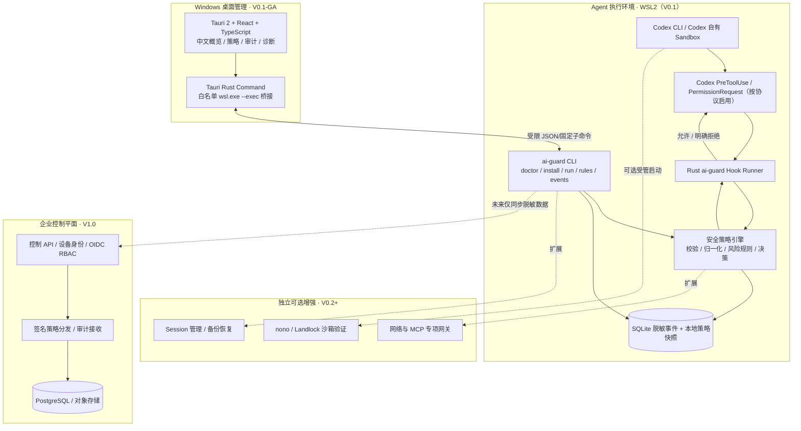
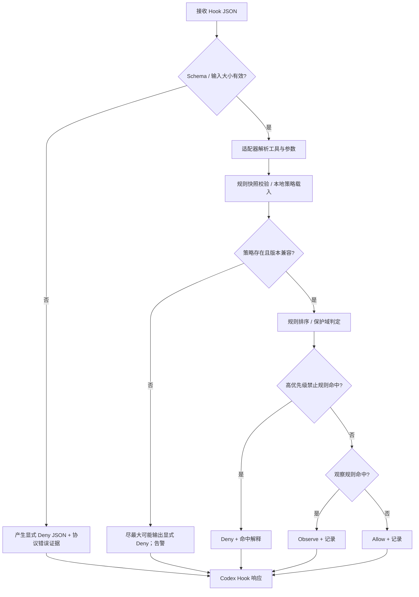
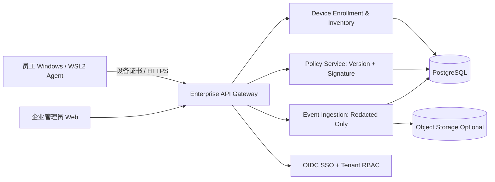

# AI卫士（AI Guard）完整技术总体方案

**文档编号：** AG-ARCH-001  
**版本：** V1.0（完整蓝图，个人版 V0.1 的实施基线）  
**日期：** 2026-11-07  
**状态：** 已提出的目标设计；**不代表代码已实现或通过安全验证**  
**研发方式：** 独立 Rust 主工程，Codex / AGY 执行编码，人工把关高风险决策  
**关联需求：** `AI卫士_产品需求文档_PRD_V0.1.md`（功能编号 FR-001 ～ FR-018）

> **一句话目标：** 做一款“真正能在可控范围内阻止 AI 编程 Agent 危险操作”的本地安全工具；在安全接入、策略引擎、覆盖诊断和审计可靠后，再扩展 Session 管理、跨 Agent 治理和企业控制台。

> **实施原则：** 任何“阻止了危险操作”的声明，必须有真实的执行前拦截 E2E 证据；Hook 之外的行为不宣称已经保护；失败路径必须明确记录、检测与展示。

---

## 0. 文档使用约定与权威边界

本文件是开发“做什么、为什么这样设计、如何验收”的技术基线。`docs/IMPLEMENTATION_BACKLOG_V1.0.md` 是阶段任务与交付门禁；`docs/AGENT_DEVELOPMENT_PROTOCOL.md` 规定 Codex/AGY 自动编码的工作流程。任何实现与本文件不一致，先写 ADR 并记录差异，不应静默更改核心安全边界。

- **已知已完成**：用户已建立 AI卫士独立工程，完成目录初始化、Git 初始化和首次提交；后端方向选定 Rust。旧工程的 M1 Session 代码在其他工程中，不能假定已经迁入。
- **尚未确认**：当前工程的实际 Cargo workspace、Codex 版本、Hook 测试证据、Windows Tauri 客户端、策略/审计模块、安全强制隔离能力。
- **来源与协议**：Codex 官方 Hooks 文档（见文末 R1）、Codex 官方仓库 Hooks Schema（R2）、HOL Guard（R3）、nono（R4）、Tauri 2（R5）。实现前以本机 Codex 版本和可复现协议测试为准。
- **名词**：观察（Observe）= 能看到/记录；拦截（Hook Deny）= Codex 支持的工具调用执行前明确拒绝；隔离（Sandbox Enforcement）= 操作系统内核或可靠执行环境实际限制。这三项不可混用。

## 1. 产品目标、边界与里程碑

### 1.1 核心目标

1. 接入现有 Codex CLI，而不是重写 Codex 客户端；用户仍可正常使用 Codex。
2. 在 **已验证覆盖的 PreToolUse 路径** 上检测高风险命令、敏感路径和工具操作，明确拒绝或允许，保留脱敏事件。
3. 提供“保护是否真的生效”的自检、安装预览、回滚和受管启动。
4. 默认离线运行、无账号、无默认遥测、无源码/完整会话上传。
5. 模块可扩展至 Claude Code/OpenCode，但不在 V0.1 同时开发多个 Agent 适配器。

### 1.2 非目标（明确排除）

- V0.1 **不是**完整终端 EDR、杀毒软件、网络全流量代理或全局数据防泄漏系统。
- V0.1 不防御同一 OS 用户主动关闭或篡改 Hook 的行为；不保证所有 MCP、云端 Hosted Tools 和特殊工具路径都被拦截。
- V0.1 不集成 Codex App Server、不要求解析全部历史 Session；Session 备份恢复列为 V0.2。
- V0.1 不建立商业授权服务器、设备统一纳管、OIDC、云端策略中心和复杂审批中心。
- 不在安全热路径引入在线大模型判断，也不把模型评分当成强制访问控制依据。

### 1.3 版本边界

| 阶段 | 版本 | 必交付 | 明确不交付 |
|---|---|---|---|
| 0 | V0.1-PoC | 原生 Hook 协议、Rust Allow/Deny、真实拒绝证据 | 桌面 UI、企业功能 |
| 1 | V0.1-Beta | 可配置规则、doctor、受管启动、审计、安装/卸载回滚 | OS 级全面隔离 |
| 2 | V0.1-GA | 中文 Tauri UI、Windows/WSL2 测试、安装包、更新与安全声明 | 全网 DLP、跨 Agent 会话迁移 |
| 3 | V0.2 | 非 Codex Agent 适配试点、Session 列表/备份/恢复、可选沙箱 PoC | 企业多租户控制平面 |
| 4 | V0.3 | 网络/MCP 专项防护、可选审批恢复、扩展规则包 | 默认全量联网审计 |
| 5 | V1.0 企业版 | 设备注册、签名策略、集中审计、OIDC/RBAC、私有化 | 默认远程命令执行员工终端 |

> 企业版架构是本文件的扩展设计，并非要求首版一次性实现。

## 2. 架构决策（必须保持稳定）

| ADR | 决策 | 理由 | 何时重新评估 |
|---|---|---|---|
| ADR-001 | 安全主线优先于 Session 管理 | 防护是产品核心差异点 | 真实拦截闭环完成后 |
| ADR-002 | Rust 模块化单体 + 小型 Hook Runner | 热路径可靠、可测试、交付简单 | 跨 Agent 规模显著扩大时 |
| ADR-003 | 在 Codex 实际执行环境安装 Hook（先 WSL2） | Windows UI 无法凭空拦截 WSL Linux 进程 | Windows 原生 Codex 单独支持时 |
| ADR-004 | Hook 判定不依赖常驻 Daemon | UI 关闭/服务重启仍可完成本地判定 | 引入企业强制审批时 |
| ADR-005 | 个人版 SQLite + TOML/JSON 策略文件 | 离线、调试简单、审计可查询 | 高并发/多用户时 |
| ADR-006 | Windows Tauri UI 用受限 `wsl.exe --exec` 命令桥接 | 避免首版裸露本地 HTTP 服务 | 实时订阅需求成熟时 |
| ADR-007 | 安全策略确定性执行，规则与风险解释可重放 | 便于自动测试和审计 | 模型辅助检测以非强制路径接入时 |
| ADR-008 | 非可信项目 Hook 不自动获得信任 | 尊重 Codex 原生信任模型 | 管理员托管策略明确时 |
| ADR-009 | 参考 HOL Guard/nono，但不继承其整体工程 | 独立产品、许可证可核查、降低架构绑定 | 成熟模块复用收益明显时 |

## 3. 系统整体架构

### 3.1 分层逻辑图



**架构关键点：**

- 安全判断必须发生在 Agent 真实执行位置。V0.1 是 WSL2 Linux Rust 二进制；Windows 只是 UI 管理入口。
- `Codex App Server` 不在上述主安全链路中。以后它为 Session、客户端交互提供服务，但不是 PreToolUse 的必要条件。
- Hook 可以显式拒绝支持的工具调用，但 Codex 工具 Hook 存在覆盖例外，且 Hook 错误/超时可以发生 fail-open（R1）。
- 只有引入并实际验证内核沙箱（例如 Linux Landlock）后，才能对某些文件/网络资源宣称 OS 强制隔离（R4）。

### 3.2 运行时进程职责

| 进程 | 位置 | 是否常驻 | 核心职责 |
|---|---|---|---|
| `ai-guard hook codex pre-tool-use` | WSL2 | 否，由 Codex 每次触发 | stdin 读 JSON → 规则判定 → stdout 返回 Codex JSON；stderr 用于受控诊断 |
| `ai-guard` CLI | WSL2 | 否 | 安装、检查、受管启动、规则测试、审计查询、回滚 |
| `ai-guard-daemon` | WSL2 | V0.1 不要求 | 未来实时事件订阅 / 企业同步队列，必须与 Hook 判定解耦 |
| `AI卫士 Desktop` | Windows | UI 运行期间 | 只执行显示/配置管理；不能成为唯一安全执行点 |
| `codex` | WSL2 | 用户使用期间 | Agent 逻辑；继续使用 Codex 自带 Sandbox 和审批 |

### 3.3 实际信任边界

1. **未信任**：Agent 生成的命令、仓库 README、外部网页、MCP 输出、Hook 的 `tool_input`，都按不可信数据处理。
2. **有条件可信**：本地用户可编辑策略文件，个人版允许主动调整；企业版必须额外验签并防止普通用户降低企业最低限制。
3. **不可假定**：本地同权限用户不能绕过保护；WSL 挂载路径不能仅靠字符串前缀判断安全；Tauri WebView 不能直接访问任意 WSL 命令。
4. **审计证据**：发生过的 Hook 调用与给出的决策，不等于证明所有未记录操作都没有发生。

## 4. 技术栈与工程组织

### 4.1 推荐技术选型

| 领域 | 选择 | 说明 |
|---|---|---|
| 本地语言 | Rust stable（提交 `rust-toolchain.toml` 锁定工具链） | 以已安装版本和 CI 可用版本为准，不凭空固定版本号 |
| 异步 | Tokio（仅网络/进程管理需要时） | Hook 热路径优先同步简化 |
| 序列化 | `serde`, `serde_json` | Codex JSON Hook 契约 |
| CLI | `clap` | 诊断、安装和自检命令 |
| 错误 | `thiserror`（库）+ `anyhow`（CLI 可选） | 可控错误码、清晰错误消息 |
| 日志 | `tracing`, `tracing-subscriber` | stdout 不写调试文本，密钥脱敏 |
| 数据库 | `rusqlite` + SQLite | 个人版单设备脱机存储，Schema Migration 显式管理 |
| 配置 | `toml`, `serde` | 可审查、可版本化规则文件 |
| 桌面 | Tauri 2 + React + TypeScript + Vite | Windows 桌面，Tauri Commands 做受限桥接 |
| UI 状态 | TanStack Query（可选）+ i18next | 只在 UI 阶段引入 |
| 测试 | Rust unit/integration + `proptest`（选用）+ E2E 夹具 | 协议契约、规则、真实行为 |
| 企业服务 | Axum + PostgreSQL + OIDC/JWT + mTLS（规划） | 不在个人版提前引入 |

**依赖策略：** 只按实际里程碑引入依赖，所有 Cargo/pnpm lockfile 入库；CI 做 SPDX/许可证及 CVE 检查。`nono`、HOL Guard、Pipelock 先研究，不得不经许可证和安全审查直接整体搬入主仓库。

### 4.2 目标目录与依赖规则

```text
ai-guard/
├── Cargo.toml                     # Workspace 根（实际保留已有有效配置）
├── Cargo.lock
├── rust-toolchain.toml
├── apps/
│   ├── local-service/            # ai-guard Rust CLI + Hook Runner
│   │   └── src/
│   │       ├── main.rs
│   │       ├── cli.rs
│   │       ├── hook.rs
│   │       ├── installation.rs
│   │       └── managed_run.rs
│   └── desktop/                  # V0.1-GA：Tauri 2 / React / TS
├── packages/
│   ├── agent-adapters/           # Codex 输入/输出解析、Capability 探测
│   ├── security/                 # 领域 Action、策略、规则、解释、决策
│   ├── storage/                  # SQLite、策略快照、审计脱敏
│   └── session/                  # V0.2 后开启
├── tests/
│   ├── fixtures/                 # 无敏感数据的 Hook 输入 / 输出样例
│   ├── protocol/
│   ├── policy/
│   └── e2e/
├── docs/
│   ├── adr/                      # 重大变更决策
│   ├── COMPATIBILITY.md          # 各版本 Codex 功能覆盖表
│   ├── IMPLEMENTATION_BACKLOG_V1.0.md
│   └── AI_Guard_Full_Technical_Design_V1.0.md
├── scripts/
├── references/                   # 只读参考源码；忽略第三方代码，保留参考说明
└── AGENTS.md                     # 工程根已有文件：合并规则，不直接覆盖
```

初期可以将模块保留在一个 Rust crate 的不同 module 内；当模块边界稳定、单测有价值时再拆成多个 crate。**不为漂亮目录结构而过度设计。**

| 模块 | 可以依赖 | 不能直接依赖 |
|---|---|---|
| `agent-adapters` | 领域事件 / Schema | SQLite、Tauri UI |
| `security` | 纯领域类型、静态规则 | Codex 原始 JSON / UI / 数据库驱动 |
| `storage` | 领域事件、序列化模型 | Agent Hook 输出逻辑 |
| `local-service` | 以上模块，组合实现 | UI 组件 |
| `desktop` | 明确定义的 CLI/IPC DTO | WSL 内的原始数据库/Hook 配置内部格式 |

## 5. Codex 原生安全接入设计

### 5.1 事件覆盖矩阵（能力以实测为准）

| 操作类别 | 首版接入方式 | 理论覆盖 | 要求验证的边界 |
|---|---|---|---|
| Shell / Unified Exec | `PreToolUse` `Bash` | 执行前拒绝已支持 | 复杂多命令、重定向、后台进程、write_stdin |
| `apply_patch` / 文件编辑 | `PreToolUse` `apply_patch` | 执行前拒绝已支持 | 参数结构、路径定位、路径竞态 |
| MCP 工具调用 | `PreToolUse` 按 MCP 工具名 | 支持的本地工具调用 | MCP server 多版本、外部/托管 MCP 例外 |
| 其他本地函数工具 | 依据 Hook 覆盖检测 | 部分支持 | 特殊工具可绕开默认路径 |
| Hosted Tools / 云端搜索 | 无通用本地 PreToolUse | 不覆盖 | 不得标“已保护” |
| Codex 原生请求审批 | `PermissionRequest` | 只在 Codex 原本需要审批时执行 | **不能**用来替代任意操作的自建人工审批 |
| 未托管 Codex/未受信 Hook | `doctor`/`run` 检测 | 可能没有保护 | 必须展示未保护/未知 |

来源：R1 Codex Hooks Tool Coverage、PreToolUse、PermissionRequest。

### 5.2 Hook 输入契约

来自 Codex 的命令 Hook 输入为 **stdin 上的单个 JSON 对象**。以下仅为契约示例，字段是否存在需允许版本差异：

```json
{
  "session_id": "session-fixture-001",
  "turn_id": "turn-fixture-001",
  "cwd": "/tmp/ai-guard-fixture",
  "hook_event_name": "PreToolUse",
  "tool_name": "Bash",
  "tool_input": {"command": "echo AI_GUARD_BLOCK_ME > ./sentinel.txt"},
  "tool_use_id": "call-fixture-001"
}
```

**解析约束：** JSON 最大体积先设建议值 1 MiB（应可配置且受测试）；未知字段保留兼容但不自动授予权限；必须检查 `hook_event_name`、类型、长度；`cwd` 仅作为上下文，不视为权限证明；对路径、命令、MCP 参数统一做长度限制和脱敏。

### 5.3 明确拒绝输出（Codex 当前官方契约）

```json
{
  "hookSpecificOutput": {
    "hookEventName": "PreToolUse",
    "permissionDecision": "deny",
    "permissionDecisionReason": "AI卫士：策略 TEST-DENY-001 禁止该测试操作。"
  }
}
```

- **Allow**：允许 Codex 继续自行执行 Sandbox 与审批流程，Hook 不得把 Codex 的权限放宽；首版可返回 `{}` 成功输出或无输出，并通过契约测试确认。
- **Deny**：优先使用官方 `permissionDecision=deny`；备用支持退出码 2 且 stderr 指示原因，但必须独立测试。
- **不准使用** `permissionDecision=ask`、旧版 `decision=approve`、`continue=false` 等尚不支持的 PreToolUse 输出形态，避免 Hook 失败且工具继续执行（R1、R2）。
- Hook 的标准输出必须是**唯一的协议消息**，调试日志一律写向受控 stderr/文件，不输出秘密。
- 同一事件可能匹配多个并发 Hook；AI卫士不能依赖对其他 Hook 的执行顺序，也不能认为自己能阻止其他 Hook 启动。

### 5.4 PermissionRequest 的用途与限制

当 Codex 自己即将弹出授权（例如受限 Shell 权限升级）时，`PermissionRequest` 可返回 `allow`/`deny` 或不作决定（保留正常提示）。它**不在普通无审批命令上发生**。V0.1 默认保留 Codex 自带审批，避免在独立 Hook 上再实现虚假的通用“暂停等待”按钮。未来企业版可对原生审批请求叠加企业规则，但仍须适配实际协议。

### 5.5 安装、信任与回滚事务

**用户手动确认的安全安装流程：**

1. `ai-guard doctor` 发现 Codex 可执行文件、版本、WSL2 环境、有效配置层、Hook 能力与现有配置。
2. `ai-guard install codex --scope user|project --dry-run` 生成配置差异及 Hook 影响列表，不修改系统。
3. 用户明确确认后执行 install：解析而非字符串粗暴替换 JSON/TOML，**合并保留**原有 Hook；持久化原始文件校验值和备份。
4. 指定一个**绝对路径**的受控 Rust Hook Runner，首版支持 Bash、apply_patch；MCP 按测试矩阵增量开放。
5. 通过配置文件原子写入（同目录临时文件 + fsync + rename）提交；出现失败时回滚上一步。避免在多个独立配置文件间声称具备跨文件原子性。
6. 告知用户打开 Codex `/hooks` 检查并信任非托管 Hook；项目级 Hook 还受项目可信配置影响。**不要自动绕过 Hook 信任提示。**
7. 执行隔离自检：安全命令通过、阻止标记无副作用，并记录证据。
8. Uninstall 只移除本产品带身份标记的 Hook；若用户/其他工具修改过配置，停止自动覆盖，给出差异和手动合并说明。

**不允许**将 `--dangerously-bypass-hook-trust` 用作产品常规流程，也不能因 Hook 配置文件存在就认定 Hook 生效（R1）。

### 5.6 受管启动与安全承诺

`ai-guard run codex -- <codex args>` 进行启动前检测：Hook 可见且启用、目标二进制存在、策略有效、规则快照完整、上次自检不超出指定时效。若不满足门禁，**拒绝由 AI卫士代为启动**。这不意味着直接启动未托管的 `codex` 也会被阻止。此局限必须同时出现在 UI 和 README。

## 6. 策略引擎：领域模型与决策流程

### 6.1 Rust 领域类型（接口设计示例）

```rust
pub enum AgentKind { Codex /* future: ClaudeCode, OpenCode */ }
pub enum ActionKind { Shell, FilePatch, McpTool, LocalTool, Unknown }
pub enum Enforcement { Allow, Deny, Observe, Unsupported }

pub struct ActionEvent {
    pub event_id: String,
    pub agent: AgentKind,
    pub tool_name: String,
    pub kind: ActionKind,
    pub cwd: Option<std::path::PathBuf>,
    pub raw_tool_args: serde_json::Value, // 内存中使用，不默认写审计
    pub session_ref: Option<String>,
    pub occurred_at: std::time::SystemTime,
}

pub struct Decision {
    pub enforcement: Enforcement,
    pub matched_rule_ids: Vec<String>,
    pub reason_code: String,
    pub display_message: String,
    pub policy_revision: String,
    pub coverage: String,            // supported / partial / unsupported / unknown
}

pub trait PolicyEvaluator: Send + Sync {
    fn evaluate(&self, event: &ActionEvent, policy: &CompiledPolicy) -> Decision;
}
```

此类型是设计契约，不是规定立即生成大量 Crate；AGY/Codex 实现时可调整字段，但不能丢失 `coverage`、`policy_revision` 和可解释原因。

### 6.2 判定流水线



关键澄清：**如果 Hook 程序根本未被启动、已经超时或输出不可读，Rust 内部想要“fail closed”不等于 Codex 会拒绝。** 本产品只能针对“已进入 Hook 且仍能返回合法 JSON”的失败尝试显式 Deny；更高强度保障需要受管启动与 OS Sandbox 两层独立技术手段。

### 6.3 规则执行顺序

1. 系统内置不可覆盖的高置信度拒绝规则（产品默认基线，个人用户可选择明确关闭特定规则并留下提示；企业版则由签名策略规定哪些不可放宽）。
2. V1.0 企业签名强制规则（个人版没有该层）；只允许团队/设备策略进一步收紧。
3. 本地用户规则。
4. 项目规则（默认只能收紧而不能放宽上层拒绝）。
5. 无命中：`Allow` 或 `Observe`，但不得将未知/未覆盖的操作显示为“已安全检查”。

规则冲突默认 **Deny 优先**；允许名单只能在同一层的适用范围内绕过相应软规则，不能覆盖已生效上层强制拒绝。规则修改采用版本化、校验、原子替换、保留上一可信快照。

### 6.4 规则文件草案（配置兼容基线）

```toml
schema_version = 1
revision = "local-0001"
mode = "protect"                  # observe | protect

[[rules]]
id = "TEST-DENY-001"
enabled = true
priority = 100
name = "拒绝安全测试标记"
agent = "codex"
tool = "Bash"
match_kind = "contains_test_marker"
match_value = "AI_GUARD_BLOCK_ME"
effect = "deny"
reason_code = "test.blocked"

[[rules]]
id = "SHELL-PIPE-EXEC-001"
enabled = true
priority = 80
name = "高风险下载并立即执行"
agent = "codex"
tool = "Bash"
match_kind = "pipeline_download_exec"
effect = "deny"
reason_code = "shell.download_execute"
```

`match_kind` 应做为受控枚举并关联可测试的 Rust 检测器，不允许任意配置字符串直接解释为 Shell 代码。对正则表达式/模糊匹配设置长度和计算限制，不把用户输入直接拼接进动态正则而缺少限制。

### 6.5 风险能力优先级与检测限制

| 策略类别 | V0.1 优先级 | 技术实现原则 | 限制 |
|---|---|---|---|
| 测试标记强制拒绝 | P0 | 确定性字符串模式，E2E 形成证明 | 仅证明 Hook 路径，不代表所有真实攻击 |
| 明确危险 Shell 模式 | P0 | 保守特征/有限 Shell 词法分析 | 别名、变量展开、间接执行存在盲区 |
| 敏感路径访问 | P0 | 对结构化路径及高置信 Shell 参数进行规范化检查 | 符号链接/路径竞态/动态路径不保证完整 |
| `apply_patch` 非授权路径 | P1 | 解析 Patch 目标路径，拒绝明显越界 | Patch 的符号链接与落盘路径需配合 Sandbox |
| MCP 工具风险 | P1 | 按已知 tool name + 参数 Schema 限制 | 未验证 server 不宣称被覆盖 |
| 下载执行/外传模式 | P1 | 识别高置信度的管道/HTTP 上传行为 | 不等于网络全流量 DLP |
| 提示词注入 / 供应链 | P2 | 外部扫描器/辅助评分，不替代核心规则 | 无法保证检测所有变体 |

**危险操作识别应先明确正例、反例和误报可接受度；不靠一个“安全大模型评分”决定是否执行。**

## 7. 防护状态与 Capability Matrix

### 7.1 防护状态是检测结果，不是安装标签

| 状态 | 定义 | UI 表示 |
|---|---|---|
| `protected_verified` | Hook 配置可信、版本已验证、自检拦截成功，且满足指定覆盖矩阵 | “已验证保护（限定范围）” + 覆盖范围 |
| `partially_protected` | Hook 有效但某些功能、工具或主机路径不覆盖 | “部分保护” + 盲区列表 |
| `unprotected` | 未安装、未启用、未信任或验证失败 | “未受保护” + 修复操作 |
| `unknown` | 版本/运行状态/自检证据不足 | “状态未知” + 检查步骤 |

禁止 UI 只根据“Hook JSON 文件存在”显示绿灯。受管启动的策略快照、Hook 校验、信任状态、真实自检必须逐项判定。

### 7.2 Capability Report Schema（示意）

```json
{
  "agent": "codex",
  "agent_version": "from-runtime",
  "host": "wsl2-ubuntu",
  "hook_registered": true,
  "hook_trusted": null,
  "pretool_bash": "verified",
  "pretool_apply_patch": "untested",
  "mcp_tools": "partial",
  "hosted_tools": "unsupported",
  "sandbox_mode": "from-runtime-or-unknown",
  "last_verified_at": "2026-11-07T00:00:00Z",
  "coverage_status": "partially_protected"
}
```

`hook_trusted=null` 表示“无法由 API 准确自动读取”，此时必须通过用户确认/真实自检补证据，不能默认为 `true`。所有真实环境字段实际读取后填充，示例值不得用作虚构运行报告。

## 8. 隐私、安全与审计

### 8.1 本地目录和权限

符合 XDG 默认约定（若环境变量存在则尊重并验证）：

```text
~/.config/ai-guard/config.toml              # 程序配置；权限建议 0600
~/.config/ai-guard/policy.toml              # 规则；权限建议 0600
~/.local/share/ai-guard/events.db          # SQLite；目录 0700、文件 0600
~/.local/share/ai-guard/backups/           # 配置事务备份（非 Session 备份）
~/.local/state/ai-guard/logs/              # 脱敏诊断日志
```

权限不允许普通其他 Unix 用户访问；但**文件权限不能防御拥有同一用户权限的恶意进程**。存在路径替换/符号链接的安装目录时，检测拒绝危险写入，尽量采用原子写入与权限收紧。

### 8.2 审计默认最小化原则

默认保存：事件时间、Agent 类型/版本、工具类型、策略版本、是否拒绝、风险类别、规则 ID、处理耗时、覆盖状态、错误码，以及**可安全展示的脱敏摘要**。

默认**不保存**：完整 Prompt、源码内容、完整 Shell 命令原文、Token、API Key、`.env` 文件内容、完整 Session 转录、Hook 原始 JSON。需要问题定位时可通过一次性显式授权临时启用局部增强日志，并自动过期、仅本地保存。不要仅做黑名单关键字替换就声称绝对不会泄漏。

### 8.3 结构化错误与告警

错误码分类建议：

- `AG-HOOK-001` 协议字段缺失/不兼容
- `AG-HOOK-002` Hook 运行超时（仅由外部诊断观察到时可判断）
- `AG-POLICY-001` 规则非法或快照损坏
- `AG-INSTALL-001` 安装冲突或配置已修改
- `AG-PRIVACY-001` 日志脱敏失败
- `AG-AUDIT-001` SQLite 写入失败
- `AG-ENV-001` Codex 不可用/Hook 未信任或禁用

遇到安全配置损坏时，Rust Hook 若能运行，尽量返回有效的明确 Deny；若 Hook 根本没执行，则状态降级为“未保护/未知”，不能对用户隐瞒。

### 8.4 审计数据表（V0.1 最小 DDL）

```sql
CREATE TABLE IF NOT EXISTS schema_migrations (
  version INTEGER PRIMARY KEY,
  applied_at TEXT NOT NULL
);
CREATE TABLE IF NOT EXISTS security_events (
  id TEXT PRIMARY KEY,
  ts_utc TEXT NOT NULL,
  agent TEXT NOT NULL,
  agent_version TEXT,
  host_kind TEXT NOT NULL,
  tool_name TEXT NOT NULL,
  action_kind TEXT NOT NULL,
  decision TEXT NOT NULL,
  reason_code TEXT NOT NULL,
  matched_rule_ids_json TEXT NOT NULL DEFAULT '[]',
  policy_revision TEXT NOT NULL,
  coverage TEXT NOT NULL,
  duration_ms INTEGER NOT NULL,
  redacted_summary TEXT,
  error_code TEXT
);
CREATE INDEX IF NOT EXISTS idx_security_events_time ON security_events(ts_utc DESC);
CREATE INDEX IF NOT EXISTS idx_security_events_decision ON security_events(decision, ts_utc DESC);
CREATE TABLE IF NOT EXISTS policy_revisions (
  revision TEXT PRIMARY KEY,
  content_sha256 TEXT NOT NULL,
  created_at TEXT NOT NULL,
  activated_at TEXT,
  source TEXT NOT NULL
);
CREATE TABLE IF NOT EXISTS integration_state (
  agent TEXT NOT NULL,
  config_scope TEXT NOT NULL,
  recorded_hash TEXT NOT NULL,
  binary_path TEXT NOT NULL,
  installed_at TEXT NOT NULL,
  PRIMARY KEY (agent, config_scope)
);
CREATE TABLE IF NOT EXISTS self_test_runs (
  id TEXT PRIMARY KEY,
  agent TEXT NOT NULL,
  codex_version TEXT NOT NULL,
  started_at TEXT NOT NULL,
  completed_at TEXT,
  allow_check TEXT NOT NULL,
  deny_check TEXT NOT NULL,
  side_effect_check TEXT NOT NULL,
  evidence_path TEXT
);
```

Migration 必须是明确版本并可回退或备份恢复；SQLite WAL 视独立运行与多进程并发测试决定；写入繁忙应有限重试；审计写入故障不得改变已得出的拒绝决策。默认可配置保留 30 天 / 100MB（建议目标，需按试点反馈调整），支持本地导出脱敏 JSON/CSV 并明确提示用途。

## 9. CLI、IPC 与桌面交互设计

### 9.1 CLI 命令契约（正式 API 的第一层）

| CLI | 行为 | 安全要求 |
|---|---|---|
| `ai-guard doctor --json` | 检测 Codex/Hook/策略/版本/受信和沙箱能力 | 只读、无密钥/源码输出 |
| `ai-guard status --json` | 返回覆盖状态和最近自检证据 | 区分 verified/partial/unknown |
| `ai-guard install codex --scope user --dry-run` | 安装变更预览 | 默认只预览，不更改配置 |
| `ai-guard install codex --scope user` | 按确认结果变更配置 | 增量合并、事务备份、可回滚 |
| `ai-guard uninstall codex --scope user --dry-run` | 卸载影响预览 | 仅识别本产品管理的配置 |
| `ai-guard uninstall codex --scope user` | 撤销本产品安装 | 用户已有配置不能丢失 |
| `ai-guard run codex -- [args...]` | 受管启动 Codex | Preflight 不通过则拒绝本次受管启动 |
| `ai-guard hook codex pre-tool-use` | Hook 热路径 | 只从 stdin 接收事件，stdout 协议输出 |
| `ai-guard rule test --input file.json --json` | 离线规则判定测试 | **不实际运行**命令 |
| `ai-guard rule validate --path policy.toml` | 规则静态检查 | 禁止暗改规则 |
| `ai-guard events list --since 24h --json` | 查看脱敏审计 | 时间与数量分页限制 |
| `ai-guard events export --redacted` | 导出记录 | 仅脱敏；导出范围明确 |
| `ai-guard self-test codex --isolated` | 临时环境的 Allow/Deny E2E | 不接触用户工程和真实密钥 |

所有提供给 GUI 的 JSON 命令必须有版本化 `api_version`，具有稳定 `code`、`message` 和 `data` 字段。CLI 文本模式可友好展示，但不可用非结构化终端文本作为桌面端稳定集成接口。

### 9.2 CLI JSON 外部契约（示意）

成功：

```json
{
  "api_version": "1.0",
  "ok": true,
  "data": {
    "agent": "codex",
    "overall": "partially_protected",
    "covered_tools": ["Bash"],
    "limitations": ["MCP coverage not yet verified"]
  }
}
```

失败：

```json
{
  "api_version": "1.0",
  "ok": false,
  "error": {
    "code": "AG-ENV-001",
    "message": "Codex Hook 未受信或尚未通过实际拦截验证",
    "recoverable": true
  }
}
```

上述成功值**为示意数据**，实现时必须从检测与证据汇总，不可直接写死为成功。

### 9.3 Windows ↔ WSL2 IPC 边界

V0.1 桌面 UI 在 Windows 运行，Rust 安全模块在 WSL2。第一阶段采用：

`React WebView → Tauri Command → Rust GUI Bridge → Windows wsl.exe --distribution <distro> --exec <absolute ai-guard binary> <approved subcommand> --json`

核心控制：

1. Tauri `invoke()` 只暴露 **明确列出的只读/配置事务命令**，禁止提供 `run_arbitrary_shell`、`exec_anything` 等通用后门。
2. 不使用 `bash -lc` 拼接任意用户输入；用 `Command` 的独立 argv 构造并对发行版名、路径、长度、输出字节数做校验。
3. Rust 处理用户输入，React 不直接打开任意文件；只允许可解释的配置范围。
4. 每个命令设置超时、最大输出和取消/失败处理；对 JSON Schema 做验证；不能把报错当成成功状态。
5. Windows GUI 与 WSL 服务可能断连，断连时显示“状态未知”，**不能让旧绿灯一直亮**。
6. 将来如果改为 localhost HTTP，必须有监听 `127.0.0.1`、随机短期凭据、Origin/CSRF 防护、速率限制和明确授权的 API 白名单；回环地址本身不是身份验证。

### 9.4 中文管理界面导航与页面契约

```text
AI卫士
├── 安全概览         /overview
├── Agent 管理       /agents
├── 安全策略         /policies
├── 风险事件         /events
├── 防护诊断         /diagnostics
├── 安装与恢复       /integrations
└── 设置与隐私       /settings
```

| 页面 | 用户任务 | 关键字段/操作 | 空状态 / 错误态 |
|---|---|---|---|
| 概览 | 是否受保护、近期风险 | 覆盖状态、Codex 版本、上次自检、拒绝数量 | 未配置时引导安装/自检，未知时给出原因 |
| Agent 管理 | 检查接入点与运行宿主 | WSL 发行版、Codex 路径、Hook 配置来源、能力矩阵 | 不支持的执行环境明确提示 |
| 策略 | 预览和管理本地规则 | 模式、规则 ID/说明、测试输入、启停、回滚 | 不合法规则禁止保存生效 |
| 风险事件 | 找到具体拒绝原因 | 时间、风险类型、规则、脱敏描述、过滤/导出 | 数据库存储错误和“没有事件”分开 |
| 防护诊断 | 证明真实防护能力 | Hook 信任、版本、覆盖、E2E、自检历史 | Hook 失败时给出可操作修复步骤 |
| 安装与恢复 | 安装/撤销 Hook | 差异预览、确认、安装、备份、回滚 | 文件被他人修改时停止覆盖 |
| 设置与隐私 | 数据保留、日志与升级 | 本地路径、保留期限、脱敏导出、更新通道 | 无授权不上传原始数据 |

V0.1 UI 不需要“Session 页面”抢占安全主线；其导航可在 V0.2 扩展。

### 9.5 页面操作的权限层级

- **只读查询**：概览、事件、doctor、已保存规则。
- **低风险本地变更**：策略文本编辑、导入前预览、重置 UI 偏好。
- **中高风险变更**：安装/卸载 Hook、更改默认拦截规则、改变数据留存，必须在本地显示文件差异与明确确认。
- **特殊高风险**：提权、禁用所有防护、绕过 Hook 信任、强制覆盖冲突配置，不交给自动化 Agent 在无人确认时实施。

## 10. 运行异常与恢复机制

### 10.1 错误/失败矩阵

| 失败点 | 用户/系统可观察现象 | AI卫士行为 | 保证边界 |
|---|---|---|---|
| Rust Hook 收到畸形 JSON | 解析失败 | 在仍能输出协议时显式 Deny + 本地诊断记录 | Hook 已执行且输出被 Codex 接收时才可拒绝 |
| 规则文件损坏 | 无法加载可信策略 | 首选上次可信快照；不存在时尝试有效 Deny | 运行器无法启动时仍可能被绕过 |
| Hook 可执行文件丢失 | Codex 报 Hook 启动失败 | doctor 标“未保护”，受管启动阻止 | 直接运行 Codex 可能继续 |
| Hook 超时 | Codex 报 Hook 超时 | 自检失败、诊断告警，降低耗时路径 | 官方可能让工具继续，不承诺 fail-closed |
| SQLite 锁定或写入失败 | 审计不完整 | 判定与审计解耦；输出明确拒绝结果；告警 | 事件存储可靠性下降，不等于安全决策失效 |
| Hook 未信任 | Codex 跳过 Hook | UI 显示未受保护/未知，提供 `/hooks` 引导 | 不可自动宣称启用 |
| Windows ↔ WSL2 失联 | GUI 查询失败 | 状态未知，不能复用旧成功状态 | Hook 仍可能在 WSL 单独工作，需重新检查 |
| 规则更新中断 | 写入失败或校验不匹配 | 采用上次完整快照；保留待恢复文件 | 不能丢失有效旧规则 |
| Codex 升级协议变化 | 契约测试失败 | 降级覆盖声明、要求重新 E2E 验证 | 不靠旧证据宣称新版本已验证 |
| 用户自行绕开受管启动 | 直接运行未托管 Codex | UI 如实提示未纳管进程/覆盖未知 | 个人版不对抗拥有同级权限的用户 |

### 10.2 版本兼容策略

`docs/COMPATIBILITY.md` 维护如下维度：Codex 版本、发行环境、Hook Event、工具类型、输入 Schema、拒绝响应方式、安装位置、是否需信任、自检证据链接、失败模式。每次更新 Codex 依赖版本时，重新运行 E2E；**无测试证据不得自动变更状态为 verified**。

### 10.3 安全更新策略

- 配置 Schema migration 有版本号，不允许将未知字段直接无视导致规则变宽松。
- 发布产物应带 SHA-256 校验值；稳定版本采用签名/可信分发策略（Windows 安装包签名需独立准备证书）。
- 版本回滚不应破坏用户规则与审计；更新前备份配置并记录前后版本。
- 自动更新先选择“用户主动检查、用户确认安装”，不在 V0.1 背景强制替换保护二进制。

## 11. 非功能需求（均为拟定目标，尚未实测）

| 类型 | V0.1 建议目标 | 测量方式 / 达标条件 |
|---|---|---|
| 响应延迟 | Hook 评估 p95 **小于 100 ms**（WSL2 参考机、离线规则），整体进程冷启动单独记录 | 1000 条固定样例 + 真实 Hook 抽样，不混淆统计口径 |
| 可靠性 | Rust 热路径不 panic、不输出无效协议；错误场景可诊断 | 错误注入与回归测试 |
| 隐私 | 默认不记录完整命令、源码、Prompt、密钥；不默认联网 | 搜索日志/SQLite/抓包检查 |
| 可恢复 | Hook 安装/卸载可回滚；旧配置内容完整保留 | 故障注入 + 文件差异比对 |
| 正确性 | 测试用例中应阻止的工具调用副作用文件**不存在** | 真实 Codex 隔离 E2E |
| 兼容性 | 首版覆盖指定的 Windows+WSL2 Ubuntu + Codex 版本组合 | 测试机版本矩阵、诊断输出 |
| 可安装性 | 最少一步初始化、明确授权；可卸载 | 全新 WSL2 干净环境验证 |
| 可观测 | 每条拒绝结果有 Rule ID、Policy Revision、脱敏 Evidence Ref | 事件—规则—自检关联检查 |
| 资源占用 | 无 UI 常驻不要求 Daemon；CLI/Hook 资源由实测记录 | 基准测试，数据回归对比 |
| 无障碍与国际化 | 简体中文默认、英文可切换；错误提示可理解 | UI 走查与国际化键检查 |

上述性能值是**目标门槛**，不是当前实测结果；如果首批 PoC 不达到，应提供基准报告并修订实施策略。

## 12. 真实防护测试策略与质量门禁

### 12.1 测试金字塔

1. **解析与契约测试**：Hook JSON 输入字段缺失、额外字段、异常工具名、超长 JSON、编码错误、合法 Deny 输出、版本变化。
2. **策略单元测试**：明确恶意模式命中、正常命令放行、规则优先级、规则非法、版本兼容、快照恢复。
3. **属性/模糊测试**：命令解析器不 panic；未知内容不导致无限运行、越界、泄漏未脱敏参数。
4. **安装集成测试**：配置文件存在/不存在、JSON 合并、历史 Hook 并存、原文件被他人修改、原子写入中断、卸载只移除己方条目。
5. **真实 Codex E2E**：独立临时 HOME、临时测试 Git 仓库、沙箱中测试标记命令，应允许的命令执行成功、应拒绝的命令**没有产生副作用**。
6. **故障注入**：引擎异常、Hook 丢失、超时、未信任、策略损坏、数据库损坏、WSL 中断，生成覆盖降级报告。
7. **跨系统 UI 验证**：Windows GUI 到 WSL2 CLI 的白名单桥接、注入防护、错误态、断连和重连。

### 12.2 关键 E2E 验收案例

| 测试编号 | 场景 | 期待证据 |
|---|---|---|
| SEC-E2E-001 | 无害命令 | Codex 实际执行，生成预期普通输出 |
| SEC-E2E-002 | 测试规则拒绝 | Hook 输出 Deny，`sentinel.txt` **不存在**，拒绝事件匹配 |
| SEC-E2E-003 | `apply_patch` 测试拒绝（若该项宣布支持） | 目标文件无变化，测试证据存档 |
| SEC-E2E-004 | MCP 工具模拟拒绝（若宣布支持） | MCP 目标 mock 未被调用 |
| SEC-E2E-005 | Hook 配置禁用/未信任 | 状态不是 protected_verified，受管启动门禁失败 |
| SEC-E2E-006 | Rust Hook 自己抛出可捕获错误 | 尽最大可能输出合法拒绝，异常可诊断 |
| SEC-E2E-007 | Hook 可执行文件不存在 | 不能宣称拦截，兼容矩阵标注实际行为 |
| SEC-E2E-008 | 配置合并安装/卸载 | 用户现有 Hook 及原配置保持不变 |
| SEC-E2E-009 | 敏感字段样例 | SQLite/log/export 不出现样例 secret 原文 |
| SEC-E2E-010 | 正常构建测试 | 不应被全局规则误阻塞 |
| SEC-E2E-011 | Codex 版本变更 | 未验证前状态降级，重新测试后恢复 |
| SEC-E2E-012 | Windows/WSL2 断连 | 桌面显示未知状态，不出现虚假“保护中” |

**测试环境限制**：不执行真实危险删除、不读取真实凭据；使用测试专用路径与伪造密钥。真实 E2E 与 Mock E2E 分开记录，不能用 Mock 结果冒充真实 Codex 拦截成功。

### 12.3 每次代码变更的最低验证

```bash
cargo fmt --all -- --check
cargo clippy --workspace --all-targets -- -D warnings
cargo test --workspace
# 桌面 UI 阶段另需：
# pnpm lint && pnpm typecheck && pnpm build
# e2e 命令由工程实际脚本确定，不能假设存在
```

发布前另运行依赖漏洞、许可证、SBOM 和敏感信息扫描。所有验证命令必须记录退出码、运行环境和产物位置；不允许只有“测试通过”四个字而无证据。

## 13. V0.2 扩展：Agent 适配、Session 管理与沙箱

### 13.1 多 Agent 适配协议

`AgentAdapter` 统一的不是一份虚构的“所有 Agent Hook 事件”，而是 **Capability Discovery + Event Normalization + Decision Translation**：

```rust
pub trait AgentAdapter {
    fn id(&self) -> &'static str;
    fn detect(&self) -> Result<DetectedAgent, AdapterError>;
    fn capabilities(&self) -> Result<AgentCapabilities, AdapterError>;
    fn normalize(&self, raw_event: &[u8]) -> Result<ActionEvent, AdapterError>;
    fn translate(&self, decision: &Decision) -> Result<Vec<u8>, AdapterError>;
}
```

每个 Agent 维护自己的 Hook/Plugin 生命周期及失败模式测试矩阵。OpenCode、Claude Code 均必须重新做原生事件和拦截能力的实测，不因为它们“也有 Hook”就宣称等价保护。

### 13.2 Session 管理模块（独立增值，不影响安全主线）

- `SessionProvider`：Agent Session 发现、只读列表、只读详情、版本标记。
- `SessionBackup`：备份 Manifest（源 Agent/版本、文件 Hash、备份时间、文件集）、安全暂存、完整性校验。
- `SessionRestore`：恢复前预览、路径冲突检测、运行会话锁定/占用检测、二次确认、临时目录→原子替换、失败回滚。
- 默认**不**随意将历史 JSONL 覆写回正在使用的 Codex 目录，**不**默认跨 Agent 格式转换等同于可继续会话。
- Codex App Server 只在需要受支持的 Session 操作时引入；安全 Hook 主链保持独立。

### 13.3 OS 沙箱选配（nono / Landlock）

nono 支持在 WSL2 Linux 中运行 Landlock 等隔离机制（R4），但其功能受内核版本和 WSL2 特性影响。独立 PoC 必须记录 `nono setup --check-only` 等能力检查、文件只读/写入白名单测试、网络/凭据代理限制、性能影响与退出恢复。若未通过，不得以“安装了 nono”替代内核验证。个人版 V0.1 继续依赖 Codex 自带 Sandbox，不把 nono 作为必须运行依赖。

## 14. 企业版 V1.0 控制平面完整规划（不阻塞个人版）

### 14.1 Open Core 仓库边界

- **公开个人版 `ai-guard`**：Agent Adapter、Rust Policy Engine、Hook Runner、CLI、Tauri UI、本地审计、基础 Session 工具（按版本范围）。
- **私有 `ai-guard-enterprise`**：设备身份与纳管、组织/租户、签名策略发布、集中查询、SSO/RBAC、企业报表与授权服务。私有项目只通过协议对接公开客户端。
- **协议独立**：客户端不因为未登录企业账户就失去本地免费保护；企业扩展模块失效不得让个人核心不可用。
- **许可证**：个人版的 Apache-2.0 为候选方案而非已正式定案；复用第三方代码前审查 SPDX、NOTICE、依赖许可证及商标；企业服务端和闭源许可独立确认。

### 14.2 企业服务组件



技术建议：Rust Axum API + PostgreSQL；OIDC（对接企业现有 IdP）；mTLS/设备证书用于设备身份；Ed25519 签名策略（钥匙分级与轮换）；审计批处理按租户隔离；企业后台的对象存储只是可选报表归档，不是首版必需的 Kubernetes/消息队列。

### 14.3 企业 API 合同草案（待 PoC 冻结）

| 方法 | 路径 | 用途 | 安全约束 |
|---|---|---|---|
| `POST` | `/api/v1/devices/enroll` | 使用短期注册码及 CSR 生成设备身份 | 单次 token、过期、设备证书轮换 |
| `GET` | `/api/v1/devices/me/policies/current` | 拉取签名策略 | ETag、版本单调、验签、过期保护 |
| `POST` | `/api/v1/devices/me/heartbeat` | 回报版本、保护覆盖、策略修订 | 仅汇总状态，不上传原始 Prompt |
| `POST` | `/api/v1/events:batch` | 上报脱敏安全事件 | 幂等批次、速率限制、租户隔离 |
| `GET` | `/api/v1/admin/devices` | 管理员查看设备 | OIDC + tenant RBAC + 审计 |
| `POST` | `/api/v1/admin/policies/releases` | 发布经过审核的签名策略版本 | 双人复核（高风险）、版本可回滚 |

上表是企业协议蓝图；具体状态码、证书分发、组织身份映射、离线时长及 SLA 需在企业试点中形成独立 OpenAPI 规范。

### 14.4 企业策略生效规则

优先级：企业强制最小安全基线 → 设备/部门策略 → 用户个人加严规则 → 项目加严规则。签名策略必须先验签后激活；离线保留**最后一个验证通过且未超过可接受离线期限**的快照；过期/无法验签时，企业托管启动不允许进入“显示已保护但实际上无有效规则”的状态。

**边界限制**：如果员工可以同权限删除 Hook、直接启动 Agent 或破坏服务，单纯签名策略并不能实现强制管控。企业实际治理须配合 MDM、设备管理策略、受限 OS 身份、受管启动与内核级隔离；不能将客户端应用层措施包装为防篡改产品。

### 14.5 多租户与隐私策略

- 数据表使用 `tenant_id` 强制隔离；管理员 OIDC 角色映射 `admin`, `security_auditor`, `policy_editor`, `device_operator`, `viewer`；租户越权测试必做。
- 默认上报**脱敏事件**、策略版本与覆盖状态；完整命令、源码内容、Prompt/Session 不默认上传。
- 管理员操作必须审计，策略发布支持审批；支持保留期限与删除流程；中国/境外部署及合规应由实际客户场景单独评估。
- 企业 license 不能是决定是否允许本地安全判断的唯一条件；云失联不能让本地已验证的安全策略突然停止。

## 15. CI/CD、发布、许可证与供应链

### 15.1 研发质量门禁

- Git 分支：`main` 稳定；`feat/*`、`fix/*`、`refactor/*`；每个独立任务在有限改动中实现。
- CI：Linux Rust 单测；Windows Tauri 构建（进入 GUI 阶段后）；依赖安全与许可证扫描；格式检查；测试覆盖报告（覆盖率不是“安全性证明”）。
- 供应链：锁文件、依赖核查、第三方源码出处与 Commit、SBOM、发布 SHA-256、可追溯构建日志。
- 开源：发布前决定 LICENSE、提交第三方 NOTICE、检查配置中是否存在真实密钥/私人 Session，校验 `references/` 没被提交进公开仓库。
- 版本升级：每次 Codex 升级必须运行协议契约和隔离 E2E；新版本未经验证时显示“兼容未知”。

### 15.2 发布与卸载

| 发布通道 | 首版交付 | 风险控制 |
|---|---|---|
| WSL2 Rust CLI | Linux 二进制或从源码安装 | 绝对路径、校验值、doctor、自检 |
| Windows Desktop | Tauri 2 安装程序 | 安装包签名计划、UI 不越权 |
| 仓库公开发布 | 源码、README、SECURITY、许可证、变更日志 | 不包含参考源码和敏感数据 |
| 企业版 | 独立部署包（后续） | 签名配置、离线容灾、租户隔离 |

卸载必须解释“卸载管理 UI”和“解除 Codex Hook 保护”是不同的动作；无论删除二进制还是变更配置，都要能提示用户当前可能失去防护。

## 16. 分阶段实施与依赖（给 Codex/AGY）

具体的可交付任务、文件范围、验收证据见 `docs/IMPLEMENTATION_BACKLOG_V1.0.md`。阶段之间的依赖如下：

```mermaid
flowchart LR
  M0[ M0: 当前工程审计 / 协议验证 ] --> M1[ M1: Rust 核心与 CLI ]
  M1 --> M2[ M2: Codex Hook E2E ]
  M2 --> M3[ M3: 策略 + 规则测试 ]
  M3 --> M4[ M4: 安装 / 信任诊断 / 回滚 ]
  M4 --> M5[ M5: 审计 / 防护状态 / 自检 ]
  M5 --> M6[ M6: 中文 Tauri UI / WSL 桥接 ]
  M6 --> M7[ M7: WSL / Windows 回归 / 发布 ]
  M7 --> M8[ M8: V0.2 Session / 多 Agent / 沙箱研究 ]
  M8 --> M9[ M9: 企业控制平面试点 ]
```



### 16.1 各阶段不可跳过的交付门禁

- **M0**：记录本机 Codex 版本、当前 Hook 协议、真实目录结构、变更基线；未知项必须写出，不凭空建接口。
- **M1**：Rust 编译、CLI 基础、JSON 解析/输出契约单测，输出无敏感字段。
- **M2**：至少一个真实 Codex 拒绝测试，具有 Hook 拒绝输出和**副作用不存在**的证据。未通过不得进入“受保护”宣传。
- **M3**：规则模式、优先级和错误配置测试通过；模拟输入可重放。
- **M4**：安装预览/确认/回滚、原有配置保存，Hook 信任状态可确认。
- **M5**：脱敏事件持久化、doctor 能检测保护失效，失败态透明。
- **M6**：Windows/WSL2 UI 桥接不执行任意 Shell，中文界面与错误态到位。
- **M7**：干净环境安装/自检/卸载回归、许可证和敏感数据扫描、可安装产物验证。
- **M8**：新增能力不得破坏已发布的安全闭环。
- **M9**：需有试点企业的部署与权限模型决策，不能凭想象提前上线商业控制平面。

## 17. 风险登记与开放问题

| ID | 风险 | 优先度 | 降低风险方式 | 决策时点 |
|---|---|---|---|---|
| RISK-01 | Hook 失败时执行继续，无法天然强制拒绝 | 极高 | 真实错误注入、受管启动、OS 沙箱专项 PoC、UI 明示 | M0–M2 |
| RISK-02 | Codex 版本变化或 Hook 信任导致保护消失 | 高 | 协议矩阵、doctor、E2E 自检、升级降级状态 | M0–M5 |
| RISK-03 | Shell/文件路径静态判断存在绕过 | 高 | 审慎规则、高置信拒绝、非完整防护声明 | M3–M7 |
| RISK-04 | 安全日志意外保存用户秘密 | 高 | 默认不存原文、脱敏与泄漏测试 | M1–M5 |
| RISK-05 | Installer 覆盖用户 Codex 配置 | 高 | 差异预览、增量合并、原子写入、冲突回滚 | M4 |
| RISK-06 | Windows UI 注入或连接错误 WSL 发行版 | 高 | 白名单命令、绝对二进制路径、发行版标识核对 | M6 |
| RISK-07 | 试图同时做多 Agent + 企业版导致首版延期 | 中高 | 先安全闭环，按里程碑严格限范围 | 全程 |
| RISK-08 | 第三方许可证/安全代码复用不合规 | 中高 | 记录出处、许可证、NOTICE、隔离研究 | M0、M7 |
| RISK-09 | 单独发布的 Hook 与 UI 版本不兼容 | 中 | 协议版本与最低兼容版本检查 | M5–M7 |
| RISK-10 | 企业版客户端被主动同用户绕过 | 高 | MDM/OS 强制边界联合设计，不夸大能力 | M9 |

## 18. 对 AGY/Codex 的交付规则

1. **先读本文件与 PRD，再读仓库现状**；不得基于方案假定当前功能已实现。
2. 一次只开发一个里程碑或一个有验收边界的 Issue；先给影响范围，再编码。
3. 不变更全局 Codex 配置、真实用户密钥、系统服务、WSL 网络/防火墙和生产设备；安装变更必须进入单独确认流程。
4. 每个任务必须提交代码、单元/集成测试、真实证据（若宣称 E2E）、文档更新、风险列表和回滚办法。
5. 禁止将 AI卫士“已拦截”的模拟结果当成真实 Codex 执行前拦截；所有真实测试只用临时仓库、临时配置及虚假秘密。
6. 代码来源和许可证必须写在引用登记表；直接复制第三方代码时额外审核许可证、作者标注及更新路径。
7. 严格区分“功能已设计”“已实现”“已通过单元测试”“已通过真实集成测试”“已公开发布”，不可跨级宣布完成。
8. 允许 AGY/Codex 自主完成低风险编码、测试、文档和本地提交；远程推送、改真实系统配置、开放网络端口、执行提权、发布、删除历史须独立授权。
9. 有冲突的安全决策必须形成 ADR；不得为了让测试通过而删除安全断言或默认放宽规则。

## 19. 参考资料与验证清单

[R1] Codex 官方 Hooks 文档（事件、Tool Coverage、Hook 信任、PreToolUse、PermissionRequest 和错误行为）：https://learn.chatgpt.com/docs/hooks  
[R2] Codex 开源仓库与 Hook Schema（实现前固定测试 Commit）：https://github.com/openai/codex  
[R3] HOL Guard（参考 Hook、审批、审计和安装策略；许可证审查）：https://github.com/hashgraph-online/hol-guard  
[R4] nono（参考 Linux/WSL2 Landlock 隔离，实际可用性需现场检测）：https://github.com/nolabs-ai/nono  
[R5] Tauri 2 IPC 文档：https://v2.tauri.app/concept/inter-process-communication/  
[R6] OpenAI Codex App Server 作为后续 Session/客户端扩展的用途：https://developers.openai.com/blog/codex-as-a-platform  
[R7] OpenAI 推荐的 Agent 工具安全边界（隔离、审批和日志）：https://developers.openai.com/api/docs/guides/agents/guardrails-approvals

### 最终验收结论的必要证据

- 真实版本及环境矩阵（不是文档示例）。
- 安全命令 Allow 的实际执行记录。
- 测试标记操作 Deny，且目标副作用文件不存在的可复核记录。
- Hook 禁用/未信任/超时/丢失时，防护状态诚实降级的记录。
- 安装、更新、卸载对原 Codex 配置无破坏的文件比对记录。
- 敏感信息在日志/SQLite/导出包中未泄露的检查证据。
- 个人版的发布包、许可证、依赖锁文件、SBOM、回滚说明与安装手册。

**最终判断：** AI卫士 V0.1 是否成功，不取决于有没有漂亮的控制台，而取决于安全闭环是否在真实 Codex 环境完成并经验证。保持这一中心，后续 AI卫士的 Session 管理和企业版商业化才有可靠底座。
