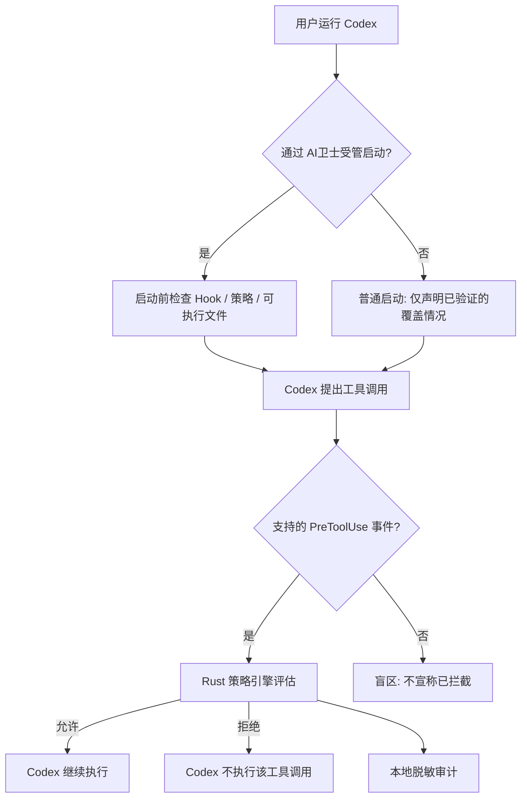

# AI卫士（AI Guard）产品需求文档 PRD

**版本：** V0.1 · 个人开源版（已重构为“Windows 宿主机中心化主控 + 宿主机/WSL2 双环境 Codex 统一纳管”，完整分阶段研发规格见 `docs/PRD_V0.1.md`）  
**文档日期：** 2026-11-07  
**文档状态：** 研发基线（产品规划与验收依据）  
**代码仓库：** `hnlikui5/ai-guard`  
**首发环境：** Windows 宿主机主控桌面端（同时纳管宿主机 `C:\Users\<User>\.codex` 桌面版/CLI 与 WSL2 `/home/<user>/.codex`），后端跨平台 Rust，开源许可证 `Apache-2.0`

> **产品一句话：** AI卫士是一款运行在 Windows 宿主机上的 AI 编程 Agent 本地安全防护与运行治理桌面软件，同时纳管宿主机下与 WSL2 下的 Codex，在各执行节点就地阻断高风险操作并在宿主机汇总展示可核查的安全审计与会话备份。

## 1. 产品定义与版本边界

### 1.1 为什么要做

使用 Codex 等 AI 编程 Agent 时，开发者可能在短时间内授权大量文件读写、命令执行和外部工具调用。风险来自误操作、被污染的仓库指令、提示词注入、危险脚本和密钥误暴露。传统杀毒工具不理解“Agent 正打算做什么”；单纯记录日志也无法在执行前拦截。

AI卫士以“**防护先于管理**”为原则，优先回答三个问题：

1. Agent 即将执行什么操作，能否在执行前识别明显风险？
2. 在当前 Codex 集成支持的范围内，能否真正让被禁止的操作不执行？
3. 用户能否清楚知道防护是否生效、被拦截什么、哪里仍有盲区？

### 1.2 产品定位

| 项目 | 定义 |
| --- | --- |
| 产品名称 | AI卫士（AI Guard） |
| 产品类型 | AI Coding Agent 运行时安全与本地治理工具 |
| 首发目标用户 | 在 Windows + WSL2 中使用 Codex CLI 的独立开发者、技术负责人 |
| 初期商业模式 | 个人版免费开源；企业集中治理能力后续商业化 |
| 核心差异化方向 | 中文化体验、透明的防护覆盖状态、Windows/WSL2 实用性、安全能力与 Session 扩展解耦 |
| 非产品定位 | 不是 Codex 的替代客户端；不是通用杀毒软件；不是完整的操作系统沙箱；不是全流量 DLP |

### 1.3 已知工程状态

用户已完成独立工程目录初始化、Git 初始化和首批代码提交，后端选用 Rust。本文定义的是**下一阶段产品目标**，未将任何安全拦截、图形界面或企业版能力描述为已开发完成。

### 1.4 版本策略

| 版本/阶段 | 交付边界 | 发布条件 |
| --- | --- | --- |
| V0.1-PoC | Codex Hook 接入、Allow/Deny、临时测试环境安全验证 | 真正证明“拒绝后工具未执行” |
| V0.1-Beta | Rust 策略引擎、受管启动、审计、配置诊断、基础中文界面 | 覆盖矩阵、失败模式、卸载回退测试通过 |
| V0.1 正式个人版 | Windows/WSL2 安装指引、保护状态、规则管理、审计查询与打包 | 完成发布门禁及开源合规检查 |
| V0.2+ | 更多 Agent、Session 管理/备份、进阶审批和可选沙箱 | 单独立项，不阻塞 V0.1 |
| 企业版 | 终端纳管、策略集中下发、RBAC、集中审计、私有化部署 | 在付费试点验证后进入研发 |

## 2. 用户画像与使用场景

### 2.1 目标用户

**U1：个人开发者（首要）**。日常通过 WSL2 使用 Codex，想降低误删代码、误访问凭据、执行不可信脚本的风险；要求工具默认本地运行，不显著干扰编码。

**U2：小团队技术负责人（次要）**。先把个人版安装在自己的工作站，验证风险规则是否有效，为未来团队策略治理收集需求；V0.1 不提供中央控制台。

### 2.2 关键场景与预期结果

| 场景 | 典型风险 | V0.1 目标行为 |
| --- | --- | --- |
| S01 破坏性 Shell 命令 | 删除非项目目录、危险递归删除 | 在支持的 PreToolUse 事件中命中规则并拒绝；记录原因 |
| S02 敏感凭据文件 | Agent 尝试读取 `~/.ssh` 或 `.env` 等敏感路径 | 对可识别的路径访问请求拒绝或告警；显示检测边界 |
| S03 高风险下载执行 | 通过管道直接执行下载脚本 | 对高置信度模式默认拒绝；提供规则解释 |
| S04 正常开发操作 | 查看源码、运行测试、查看 Git 状态 | 按默认策略允许，不产生无意义阻塞 |
| S05 Hook 失效 | Hook 被禁用、未信任、程序路径错误 | 诊断页显示“未受保护/部分保护”；受管启动进行前置检查 |
| S06 策略误拦截 | 新增规则误伤正常命令 | 可以查看命中规则、在审计中定位、回滚规则版本 |
| S07 开发者关闭软件 | 管理界面不在前台 | 安全 Hook 运行能力不依赖桌面窗口常驻；具体覆盖需经验证 |

### 2.3 典型用户故事

- **US-01：** 作为开发者，我希望安装后能一眼知道当前 Codex 是否真正处于受保护状态，而不是只看到“已安装”。
- **US-02：** 作为开发者，我希望高风险命令在执行前被阻止，并看到简洁的中文原因。
- **US-03：** 作为开发者，我希望默认允许普通构建与测试，避免安全工具成为工作阻力。
- **US-04：** 作为开发者，我希望能够在不修改真实系统配置的情况下测试一条新规则。
- **US-05：** 作为开发者，我希望禁用或卸载 AI卫士时能恢复原配置，并知道哪些保护随之失效。
- **US-06：** 作为开发者，我希望隐私数据默认留在本地，且审计记录不会再次泄漏密钥。

## 3. 核心业务闭环



**特别说明：** Codex Hook 错误、超时、返回不兼容格式时，操作可能继续；Hook 并不是强制性的 OS 安全边界。受管启动可以阻止“不合规配置启动”，不能代替操作系统隔离，也无法防止运行中所有绕过行为。详见技术方案及官方 Hooks 文档 [R1]。

## 4. V0.1 功能需求清单

优先级含义：**P0 = V0.1 必须具备；P1 = V0.1 优化项，可在 Beta 后补齐；P2 = 后续版本**。所有功能都需附真实测试证据。

### 4.1 接入与防护状态（P0）

| 编号 | 功能与关键要求 | 验收口径 |
| --- | --- | --- |
| FR-001 | Codex 环境识别：版本、实际可执行文件、运行环境、配置来源 | 检测结果可复核；不读取认证密钥 |
| FR-002 | Hook 保护安装：选择项目级或用户级；预览文件差异、明确授权 | 不覆盖已有 Hook；可安全撤销变更 |
| FR-003 | 受管启动：`ai-guard run codex` 先检测 Hook 是否启用、受信任、路径正确 | 检查不通过则拒绝受管启动并说明原因 |
| FR-004 | 防护状态：已生效、部分保护、未保护、未知 | 每种状态给出检测依据，不以安装成功代替生效验证 |
| FR-005 | 自检向导：安全命令允许、测试标记命令拒绝 | 生成真实测试记录；拒绝用模拟数据表示成功 |
| FR-006 | 恢复与卸载：保留原配置快照、撤销本产品改动 | 用户原有自定义 Hook 不丢失 |

### 4.2 安全策略与执行前拦截（P0）

| 编号 | 功能与关键要求 | 验收口径 |
| --- | --- | --- |
| FR-007 | Rust 策略引擎：统一判定 Allow / Deny / Observe | 输入、输出稳定，单元测试可重放 |
| FR-008 | Shell 高风险规则：高置信度危险命令与下载执行模式 | 定义测试用例中命中准确；不宣称可解析任意 Shell 语义 |
| FR-009 | 敏感路径规则：常见凭据路径、用户自定义保护路径 | 可解析且在接入覆盖范围内的访问被拒绝；无法识别时标注限制 |
| FR-010 | Codex PreToolUse 适配：支持符合版本的输入、输出协议 | 拒绝操作后，测试副作用标记不存在 |
| FR-011 | 两种模式：观察模式、保护模式 | 观察模式只记录；保护模式对命中拒绝规则返回 Deny |
| FR-012 | 规则配置：本地规则查看、启用、禁用、校验、导入/导出 | 错误配置不得静默替换成更宽松的保护策略 |
| FR-013 | 规则命中解释：显示规则 ID、风险原因、执行结果 | 支持从事件跳转到规则；敏感参数必须脱敏 |

### 4.3 审计、诊断与交互（P0）

| 编号 | 功能与关键要求 | 验收口径 |
| --- | --- | --- |
| FR-014 | 本地安全事件：时间、Agent、工具、规则、Allow/Deny、失败信息 | 断网可用；支持过滤；默认不写入原始密钥 |
| FR-015 | 防护诊断：Hook 启用、信任状态、文件完整性、版本、测试结果 | 失效有明显提示，不显示虚假的“全面防护” |
| FR-016 | 中文管理界面：概览、Agent、策略、事件、诊断、设置 | 中文为默认；关键流程可不依赖 CLI 完成 |
| FR-017 | 本地隐私：不上传提示词、源码、Session 或审计数据 | 默认无云端账户和外部遥测；日志隐私测试通过 |
| FR-018 | 帮助与免责声明：展示支持范围和已知盲区 | 首次启用与诊断界面均可查看 |

### 4.4 后续版本，不纳入 V0.1 发布承诺

| 能力 | 计划阶段 | 推迟理由 |
| --- | --- | --- |
| Session 列表、备份、恢复、跨 Agent 迁移 | V0.2+ | 属于运行治理增值能力，不应抢占首版安全资源 |
| Codex App Server 深度集成 | V0.2+ | 首版拦截可直接使用 Hook，不依赖 App Server |
| 非 Codex Agent 接入 | V0.2+ | 各 Agent Hook 覆盖与审批行为不同，需逐个验证 |
| 通用人工审批中心 | V0.2+ | `PreToolUse` 不能通过 `ask` 触发任意操作审批 |
| MCP 代理全链路治理、出口过滤 | V0.3+/企业版 | 只有经过受控代理的流量才可保证相应覆盖 |
| OS 级强制沙箱及策略加固 | 单独 PoC 后确定 | 必须评估 nono/系统能力与 WSL2 兼容性 |
| 团队管理、SSO、RBAC、统一审计 | 企业版 | 非个人版的付费价值，不进入首版 |

## 5. 安全规则产品设计

### 5.1 策略基本逻辑

每条策略至少包含：`规则 ID`、`名称`、`启用状态`、`适用 Agent/工具`、`匹配条件`、`风险等级`、`动作`、`用户可见原因`、`规则版本`。

V0.1 只承诺 Allow、Deny、Observe 三类决策；**不使用 `PreToolUse ask`**。需要人工审批的操作，先保留 Codex 原生 `PermissionRequest` 流程，后续再独立建设审批中心。

### 5.2 规则执行原则

1. 本地高优先级拒绝规则优先；其他规则按明确的优先级与命中顺序执行。
2. 对未匹配的操作维持 Codex 自身 sandbox / approval 机制，AI卫士不主动放宽原权限。
3. 可识别的高风险规则在保护模式中拒绝；模糊或无法判定的情况不可虚报“已保护”。
4. 允许用户查看、测试并回滚规则；高风险例外须明确提醒并记录。
5. 严禁把命令字符串正则匹配当作任意文件操作或网络行为的完整防护证明。

### 5.3 初始规则包（建议）

| 规则组 | 示例 | 默认建议 | 边界 |
| --- | --- | --- | --- |
| 破坏性操作 | 对系统根目录或非项目重要目录的高风险删除意图 | 保护模式拒绝高置信度命中 | 无法解析间接脚本的全部副作用 |
| 凭据保护 | 显式读取 `.ssh` 私钥、云凭据、`.env` 等路径 | 保护模式拒绝可确认命中 | 正常程序内部读文件未必经 Hook 直接可见 |
| 下载并执行 | `curl/wget` 结果直接交给 Shell 执行的明显模式 | 默认拒绝 | 复杂混淆/别名可能漏检 |
| Git 高风险 | 明显覆盖式重置或危险推送意图 | 先观察，规则校准后保护 | 应避免误伤合法维护操作 |
| 正常开发 | 查看状态、运行测试、常规构建 | 允许 | 不改变 Codex 自带沙箱/审批 |

## 6. 页面级需求与交互

### 6.1 页面结构

```text
AI卫士个人版
├─ 安全概览
├─ Agent 管理（首期 Codex）
├─ 安全策略
├─ 安全事件
├─ 防护诊断
└─ 设置 / 帮助
```

### 6.2 页面清单

| 页面 | 核心内容 | 关键交互 | 异常与空状态 |
| --- | --- | --- | --- |
| 安全概览 | 当前防护状态、最近拦截、保护模式、风险提醒 | 启用保护、启动诊断、查看事件 | 无事件显示正常空状态；未保护显示原因 |
| Agent 管理 | Codex 版本、WSL 发行版、Hook 来源、配置健康 | 安装/卸载 Hook、受管启动说明 | 未安装 Codex、版本不兼容、Hook 未信任 |
| 安全策略 | 规则组、模式、命中逻辑、规则来源 | 启停、编辑用户规则、验证、回滚 | 规则校验失败不得自动启用 |
| 安全事件 | 时间线、工具、动作、风险等级、规则 ID | 过滤、查看脱敏详情、导出本地报告 | 日志损坏或不可读取需提示 |
| 防护诊断 | Hook 状态、协议检查、策略加载、受管启动检查、覆盖矩阵 | 一键自测、复制诊断摘要 | 部分保护和未知状态须有明确提示 |
| 设置 / 帮助 | 中文语言、审计保留周期、启动设置、隐私说明 | 导入导出配置、清理日志、恢复配置 | 删除前二次确认，防止误清理 |

### 6.3 关键交互详细要求

**首次安装：** 环境扫描 → 展示将修改的 Codex 配置路径及 Diff → 用户确认 → 备份原文件 → 写入 Hook → 验证信任与加载状态 → 安全测试 → 展示“已验证的保护范围”。任何失败均展示明确的恢复操作。

**高风险操作：** Codex 触发受支持的执行前事件 → Hook 提交结构化数据 → 策略判定 Deny → 返回当前 Codex 协议要求的拒绝结果 → Codex 不运行目标操作 → 日志中出现脱敏事件 → UI 显示风险原因和规则。

**诊断失败：** 显示“未受保护/部分保护/未知”，提供定位信息；禁止将“Hook 文件存在”直接等同“拦截生效”。

**规则变更：** 编辑 → 校验 → 使用测试样例模拟 → 显示预计匹配差异 → 用户确认启用 → 保存版本快照 → 后续可回滚。

**保护移除：** 展示将移除的 AI卫士相关配置，保留用户其他 Hook；撤销后重新检测，提示保护失效。

## 7. 数据与隐私需求

### 7.1 默认数据处理

- 本地存储策略配置、安装记录、防护自检和审计事件，不要求注册账号。
- 默认不上传源代码、提示词、原始 Session、终端文件或审计事件。
- 审计默认保存**操作摘要和脱敏字段**：时间、Agent、工具、规则、结果、可选路径摘要、诊断信息。
- 不把 API Key、Token、私钥内容或完整 `.env` 内容写入日志；导出前再次脱敏。
- 日志可配置保留天数，删除操作需要确认；日志不承诺能抵抗同一用户完全篡改。

### 7.2 数据对象

| 对象 | 主要字段 | 数据位置 |
| --- | --- | --- |
| AgentInstallation | Agent、版本、可执行路径、WSL 发行版、Hook 位置、状态 | SQLite |
| PolicyVersion | 版本号、摘要、创建时间、生效状态、规则内容 | 本地配置 + SQLite 元数据 |
| SecurityEvent | 事件 ID、时间、工具、动作、规则、脱敏摘要、判定耗时 | SQLite |
| DiagnosticRun | 检查项、结果、错误码、测试证据、时间 | SQLite |
| ConfigSnapshot | 备份路径、原文件哈希、变更时间、恢复标记 | 用户私有配置目录 |

## 8. 非功能性需求

| 类别 | V0.1 目标 / 约束 |
| --- | --- |
| 性能 | 本地策略判定目标 P95 ≤ 50 ms；包含 Hook 进程启动的端到端 P95 目标 ≤ 250 ms，需在指定测试机实测并公布 |
| 稳定性 | CLI 与测试场景可重复运行；正常开发命令不应频繁误拦截 |
| 安全 | 受管启动检测失败必须中止该次受管启动；Hook 运行时失败不能虚报为已阻止 |
| 可用性 | 新用户从安装到完成一次真实拦截测试的目标时间 ≤ 10 分钟（有前置环境） |
| 兼容性 | 第一版主要支持 WSL2 中的 Codex CLI；Windows 原生 Codex 与 IDE 插件不作无条件承诺 |
| 可观测性 | 每次判定具有事件 ID、规则命中和判定结果；可定位失效路径 |
| 本地化 | 简体中文默认，保留未来英文资源结构 |
| 隐私 | 默认离线可用，不要求账号，不默认上传数据 |
| 可维护性 | 模块化 Rust，接口版本化，第三方源码置于只读参考目录 |

上述数字是**发布目标，不是已测得的性能结论**。

## 9. 验收测试与发布门禁

### 9.1 关键测试清单

| ID | 输入/条件 | 必须观察到的结果 |
| --- | --- | --- |
| AT-01 | 合法测试命令 | 命令确实执行且可查询允许记录 |
| AT-02 | 带有测试专用拒绝标记的命令 | PreToolUse 返回拒绝；副作用标记文件不存在 |
| AT-03 | 高置信度危险命令样例（仅在临时测试目录） | 按策略拒绝，原测试数据无损 |
| AT-04 | 错误 Hook JSON 与缺少关键字段 | 记录错误、不崩溃；真实 Codex 失败行为如实呈现 |
| AT-05 | Hook 被禁用、未信任、二进制路径错误 | 诊断明确显示未保护；受管启动拒绝启动 |
| AT-06 | 策略文件缺失/格式错误 | 启动前检查拒绝受管启动；不自动回退宽松配置 |
| AT-07 | 规则新增、禁用和回滚 | 结果可重复、历史可查，其他规则保持不变 |
| AT-08 | 导出审计 | 不包含测试凭据原文和敏感文件内容 |
| AT-09 | 正常查看/测试/构建 | 不产生无关拒绝；有性能记录 |
| AT-10 | 多来源 Hook 并存 | 无法保证的并发行为有诊断提示；不覆盖用户设置 |
| AT-11 | WSL2 重启和管理界面关闭 | 防护状态可重新验证，服务停机不被误显示为正常 |
| AT-12 | 卸载 AI卫士 Hook | 原 Codex 配置正确恢复，剩余第三方 Hook 不受损 |

### 9.2 V0.1 发布必要条件

1. **真实拦截通过**：至少在受支持的 Shell 工具路径上，拒绝后副作用不存在；不能只验证策略引擎返回 Deny。
2. **防护边界透明**：发布文档包含 Hook 版本支持矩阵、失效场景、未覆盖操作类型。
3. **隐私合规通过**：审计、导出和异常日志均经过秘密信息泄漏检查。
4. **安装/撤销可靠**：不破坏用户已有 Codex 配置，安装与回滚测试通过。
5. **质量门禁通过**：Rust 格式、Clippy、单元测试、集成测试、至少一组真实 Codex E2E 测试通过。
6. **开源发布检查**：许可证、第三方 NOTICE、依赖安全检查、发布包校验与 README 说明齐备。

## 10. 研发任务拆分（GitHub Issues 候选）

| 里程碑 | 工作包 | 依赖 | 完成定义 |
| --- | --- | --- | --- |
| M1 | Codex Hook 协议调研与兼容矩阵 | 工程已初始化 | 固定测试版本、生成样例与契约测试 |
| M2 | Rust 最小策略引擎与拒绝结果适配 | M1 | Allow/Deny 与真实标记拦截通过 |
| M3 | 配置安装、受管启动与保护状态诊断 | M2 | 安装/测试/回退闭环跑通 |
| M4 | 审计存储、规则管理与脱敏 | M2 | 可查询事件、规则回滚和隐私测试 |
| M5 | 中文 Tauri 界面与 Windows/WSL2 桥接 | M3/M4 | 六个核心页面实现主流程 |
| M6 | 安全覆盖、回归、打包和开源发布 | M1–M5 | 发布门禁逐条通过 |

## 11. 企业版边界与差异化方向

**个人版永久免费价值：** 单设备本地安全策略、受支持的 Codex 执行前阻断、审计记录、保护状态诊断、中文管理界面；未来可提供 Session 本地数据保护。

**企业版商业价值：** 设备资产与 Agent 发现、受控策略下发、审批/例外工作流、组织权限、集中审计、数据保留、管理员报表、私有化部署与企业合规集成。不得把尚未具备的功能写成当前能力。

## 12. 风险、待决策与术语

| 项目 | 风险或待决策 | 默认处理 |
| --- | --- | --- |
| Codex Hook 协议持续变化 | 版本差异造成规则不生效 | 固定测试版本、契约测试、兼容矩阵 |
| Hook 失效可能继续执行 | 无法承诺 Hook 强制拒绝 | 显示风险、受管启动校验、后续独立沙箱 PoC |
| 同权限用户可绕开保护 | 个人版无强制设备管理权 | 明示本地信任边界；企业版单独设计 |
| Windows 与 WSL2 双环境 | 执行位置和 UI 位置不同 | 检测执行发行版，首版只对 WSL 内 Codex 声明保护 |
| 安全规则误报 | 降低开发体验 | 高置信度默认拒绝，低置信度先观察 |
| 产品开源许可 | 影响后续分发与复用 | 发布前确定许可证，核验第三方 NOTICE |

**术语：** Hook = Agent 生命周期接入点；PreToolUse = 工具执行前事件；Deny = 通过受支持协议拒绝该工具调用；受管启动 = AI卫士检查条件后启动 Codex；防护覆盖 = 在实际运行环境经过测试验证的操作路径；Session = Agent 会话与相关状态数据。

## 13. 参考资料

- [R1] Codex Hooks 官方文档：https://learn.chatgpt.com/docs/hooks
- [R2] Codex Sandbox 与审批：https://learn.chatgpt.com/docs/agent-approvals-security
- [R3] Codex Sandbox 说明：https://learn.chatgpt.com/docs/sandboxing
- [R4] HOL Guard 开源仓库：https://github.com/hashgraph-online/hol-guard
- [R5] nono（OS 沙箱参考）：https://github.com/nolabs-ai/nono
- [R6] Tauri v2 架构：https://v2.tauri.app/concept/architecture/

**结语：** V0.1 以“被支持的高风险操作可以被真实拒绝，且用户看得见保护边界”为发布核心。Session 管理与企业集中管控属于后续产品线，不反向主导首版架构。
