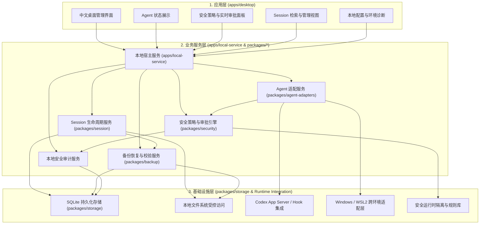

# AI卫士（AI Guard）系统架构设计

## 1. 架构设计目标与原则

AI卫士采用**模块化单体架构（Modular Monolith）**，优先保障个人版在 Windows + WSL2 本地环境中的独立、轻量、可靠运行，同时在模块边界上为未来多 Agent 扩展与企业版演进预留清晰接口。

### 核心架构原则

1. **本地优先与零重型依赖**：个人版所有核心能力（策略裁决、会话索引、备份恢复、审计存储）均在用户本地闭环完成，不依赖外部云端服务、消息队列或容器集群。
2. **严格分层与单向依赖**：UI 界面层不直接穿透访问底层文件或数据库；基础设施层细节不反向污染核心领域逻辑。
3. **适配与内核解耦**：Agent 接入协议（如 Codex App Server）与内部安全策略评估、通用 Session 管理解耦，确保未来新增 Claude Code、OpenCode 时无需重构安全内核与存储层。
4. **默认安全与失败可控（Fail-Closed）**：安全拦截链路出现任何解析异常、通信中断或审批超时，一律按阻断或人工确认处理，杜绝异常放行。
5. **只读优先与先备后改**：对 Agent 内部会话数据默认只读采集；任何清理、恢复或配置重写操作强制前置备份与完整性校验。

---

## 2. 系统分层架构

系统自顶向下划分为三层：**应用层（Application Layer）**、**业务服务层（Business Service Layer）** 与 **基础设施层（Infrastructure Layer）**。

---

## 3. 核心模块职责与边界

### 3.1 应用层

| 模块路径 | 核心职责 | 架构边界约束 |
| :--- | :--- | :--- |
| `apps/desktop` | 提供全中文桌面 UI、Agent 状态面板、拦截弹窗审批、Session 浏览检索、备份恢复操作及本地设置。 | 仅通过本地受控 API 与 `apps/local-service` 通信；严禁直接读写 Agent 数据目录或直接操作 SQLite。 |

### 3.2 业务服务层

| 模块路径 | 核心职责 | 架构边界约束 |
| :--- | :--- | :--- |
| `apps/local-service` | 本地后台守护进程，负责聚合内部各业务包能力，向桌面端提供统一接口，并协调跨环境（Windows/WSL2）通信与审计记录落盘。 | 仅监听本地回路或受控管道，不暴露公网端口。 |
| `packages/agent-adapters` | 封装具体 Agent 的协议对接与状态探测（V0.1 针对 Codex App Server 及本地会话目录只读探测），将 Agent 动作转换为统一内部事件。 | 不包含具体安全规则判断；不直接管理通用数据库 Schema。 |
| `packages/security` | 安全风险分类、策略规则匹配（Allow / Prompt / Deny）、人工审批等待队列、默认安全（Fail-Closed）裁决与审计事件生成。 | 与具体 Agent 的 Hook 实现解耦，仅接收标准化动作上下文并输出裁决结果。 |
| `packages/session` | Session 原始文件安全读取、结构化解析、元数据与全文索引构建、会话检索及归档清理。 | 对活跃 Session 坚持只读访问；执行删除或覆盖前必须调用 `packages/backup`。 |
| `packages/backup` | 提供 Session 及关键配置的快照创建、SHA-256 完整性校验、原子恢复与备份轮转清理。 | 恢复前强制验证校验和，校验不通过立即中止并告警。 |

### 3.3 基础设施层

| 模块路径 | 核心职责 | 架构边界约束 |
| :--- | :--- | :--- |
| `packages/storage` | 统一管理本地 SQLite 数据库连接、Schema 迁移、事务控制与本地受控目录结构（索引库、审计表、备份元数据）。 | 向上层提供清晰的数据访问接口，屏蔽底层存储细节。 |
| 运行时与跨环境适配 | 包含 Codex App Server 通信客户端、Windows 与 WSL2 路径转换（如 `/mnt/c/...` 与 `\\wsl.localhost\...` 双向映射）及安全运行时组件。 | 封装在适配层与存储层内部，避免平台特定代码散落到业务层。 |

---

## 4. 关键交互链路与跨环境设计

### 4.1 Windows 桌面端与 WSL2 内 Codex 通信架构

在当前典型开发环境（Windows 宿主机运行桌面 GUI，WSL2 Ubuntu 内运行 Codex 及开发工具链）下，推荐采用**“WSL2 内置本地服务 + Windows 桌面端跨边界连接”**模式：

1. `apps/local-service` 直接运行在 WSL2 Ubuntu 环境内（与 Codex 处于同一 Linux 命名空间与文件系统），确保对 Codex App Server、Linux 进程状态及 `~/.codex` 会话目录拥有原生、低延迟、无文件锁兼容性问题的访问能力。
2. Windows 宿主机的 `apps/desktop`（Tauri 桌面端）通过 WSL2 本地回路映射（`127.0.0.1` 受控端口 + 本地鉴权 Token）或通过 `wsl.exe` 标准输入输出通道（Stdio JSON-RPC）与 WSL2 内的 `apps/local-service` 通信。
3. 这种边界划分彻底避免了从 Windows 侧通过 9P 文件系统（`\\wsl.localhost\`）高频读写 Linux 下 SQLite 数据库或 Session 文件带来的性能衰减与文件损坏风险。

### 4.2 个人版向企业版演进的预留边界

为避免过度设计，V0.1 不实现任何企业版代码，仅在架构上保持以下三处干净边界：

1. **策略提供者边界（Policy Provider）**：`packages/security` 从本地配置加载规则，未来可扩展只读合并远端企业基线策略。
2. **审计接收器边界（Audit Sink）**：审计事件在 V0.1 仅写入本地 SQLite，未来可旁路挂载企业审计上报通道。
3. **身份与审批通道边界**：审批请求在 V0.1 仅推送本地桌面端弹窗，未来可扩展企业 IM / 审批流回调。

---

## 5. 技术栈选型评估与建议

结合工程现有环境（已安装 Node.js `v18.19.1`、pnpm `10.11.0`、Python `3.12.3` + `uv`，暂未安装 Rust 工具链）及 M1 历史成果，技术栈评估如下：

| 架构层次 | 推荐技术选型 | 选型理由 | 潜在风险与应对措施 |
| :--- | :--- | :--- | :--- |
| **桌面端 (`apps/desktop`)** | **Tauri 2.x + React + TypeScript** | 相比 Electron 内存占用极低、安装包小；Tauri 外壳仅负责窗口管理、系统托盘与原生通知，前端使用成熟的 React + TS 生态快速构建中文管理界面。 | **风险**：当前 WSL2 环境尚未安装 Rust（`rustc`/`cargo`），且在 WSL2 中直接编译运行 Windows 原生 GUI 较繁琐。 **应对**：开发初期前端 UI 可通过 Vite 在浏览器快速联调；待进入桌面打包阶段再按需安装 Rust 工具链，不阻塞早期核心服务研发。 |
| **本地服务 (`apps/local-service`) & Session/备份 (`packages/session`, `packages/backup`)** | **Python 3.12 (FastAPI / Asyncio)** 或 **TypeScript (Node.js)** *（优先推荐 Python 3.12 承接本地服务与 M1 成果）* | 1. 当前环境已具备完整的 Python 3.12.3 与高速包管理器 `uv`； 2. 可最大化平滑复用既有 M1 阶段的 Codex Session 管理成果； 3. 参考项目 HOL Guard 主体同样采用 Python + Rust 混合架构，Python 便于快速实现本地 API、SQLite 操作与文件处理。 | **风险**：Python 单文件分发体积较大。 **应对**：通过 `uv` 管理独立虚拟环境；WSL2 环境下原生自带 Python 3.12，无需打包重型解释器即可运行本地服务。 |
| **安全核心 (`packages/security`)** | **分阶段演进：V0.1 先用 Python/TS 实现规则引擎原型，关键高性能/隔离组件按需引入 Rust** | 1. 遵循“不因为选择 Tauri 就强制所有后端使用 Rust”的原则； 2. V0.1 核心在于跑通拦截闭环、策略模型与审批状态机，使用与 `local-service` 相同的语言（Python）可消除跨语言调用开销； 3. 待集成类似 `nono` / `Pipelock` 的底层沙箱或高频扫描能力时，再以独立 CLI 或 PyO3/N-API 扩展形式引入 Rust。 | **风险**：纯应用层拦截若缺乏 OS 级沙箱配合，可能被复杂脚本绕过。 **应对**：V0.1 明确聚焦 Codex 官方 Hook / App Server 协议层拦截与静态规则分析，并在后续版本集成 OS 级隔离机制。 |
| **数据存储 (`packages/storage`)** | **SQLite (开启 WAL 模式) + 本地受控文件目录** | 零配置、单文件事务安全、天然支持 FTS5 全文检索（极适合 Session 内容搜索），Python 标准库原生内置 `sqlite3`。 | **风险**：跨 Windows/WSL2 的 9P 文件系统操作 SQLite 易锁死。 **应对**：强制将 SQLite 数据库文件存放在 WSL2 原生 Linux 文件系统内，由 `local-service` 独占访问。 |
| **Agent 接入 (`packages/agent-adapters`)** | **Codex App Server 协议集成 + 本地 Session 目录只读解析** | 官方标准接口结合本地文件只读扫描，既能实时感知与控制运行态动作，又能在 Codex 离线时浏览管理历史会话。 | **风险**：Codex 版本迭代可能导致内部 Session 格式或 App Server 字段微调。 **应对**：将所有 Codex 特定字段解析严格收敛在 `packages/agent-adapters` 与解析器适配层中，并建立多版本样本回归测试。 |
