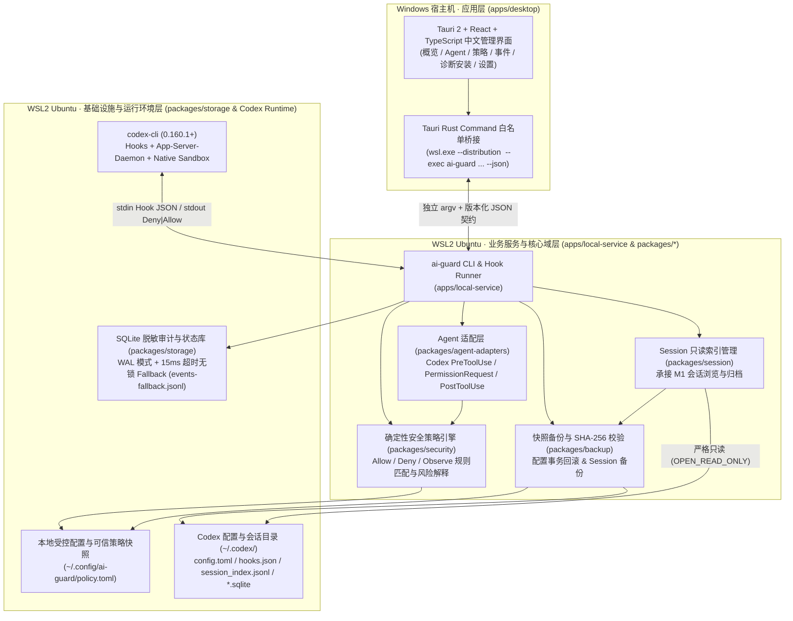

# AI卫士（AI Guard）系统架构设计

## 1. 架构设计目标与原则

AI卫士采用**模块化单体架构（Modular Monolith，基于 Rust Cargo Workspace）**，优先保障个人版在 Windows + WSL2 本地环境中的独立、轻量、可靠运行，同时在模块边界上为多 Agent 扩展与企业版演进预留清晰接口。

### 核心架构原则

1. **安全拦截优先与零重型依赖**：个人版所有核心能力（Hook 执行前策略裁决、配置与会话备份恢复、脱敏审计存储、环境诊断）均在用户本地闭环完成，不依赖外部云端服务、消息队列或容器集群。
2. **靠近执行侧的无守护进程（Daemonless）热路径**：`ai-guard hook codex pre-tool-use` 直接运行在 WSL2 Ubuntu（Codex 真实执行环境）内，单次调用即可独立读取本地可信策略快照完成判定，桌面 UI 关闭不影响安全拦截生效。
3. **严格分层与单向依赖**：桌面 UI 界面层仅通过受控白名单命令桥接访问本地服务能力，不直接穿透访问底层文件或 SQLite 数据库；基础设施层细节不反向污染核心领域逻辑。
4. **适配与内核解耦**：Agent 接入协议（`packages/agent-adapters`）与内部确定性安全策略引擎（`packages/security`）、通用 Session 管理（`packages/session`）解耦。
5. **诚实安全边界与 Fail-Closed**：
   - 在已进入 Rust Hook 进程且能返回合法协议的范围内，任何解析失败、策略损坏或未知输入均显式返回 `permissionDecision = "deny"`（Fail-Closed）。
   - 严格区分 `Observe（观察）`、`Hook Deny（协议层拒绝）` 与 `Sandbox Enforcement（内核强制隔离）`，通过四态状态机（`protected_verified` / `partially_protected` / `unprotected` / `unknown`）如实呈现保护范围。
6. **只读优先与先备后改**：对 Agent 内部会话数据（如 `~/.codex` 下的 JSONL 与 SQLite）强制只读访问；任何修改用户配置或清理会话的操作强制前置调用 `packages/backup` 完成快照备份与 SHA-256 完整性校验。

---

## 2. 系统分层架构

系统自顶向下划分为三层：**应用层（Application Layer）**、**业务服务与核心域层（Core & Service Layer）** 与 **基础设施层（Infrastructure Layer）**。

---

## 3. 核心模块职责与依赖边界

| 模块路径 | 核心职责 | 允许依赖 | 严禁直接依赖 |
| :--- | :--- | :--- | :--- |
| `apps/desktop` | 提供全中文桌面 UI（6 大核心页面）、配置变更 Diff 二次确认、断连状态感知与通过 `wsl.exe --exec` 调用 WSL2 CLI。 | 明确版本化的 CLI JSON DTO | WSL2 内部 SQLite 文件、`~/.codex` 原始文件、任意拼接的 `bash -lc` 命令 |
| `apps/local-service` | 编译产出 `ai-guard` 二进制：提供 `hook` 热路径入口、`doctor`/`status`/`self-test` 诊断、`install`/`uninstall` 事务、`run` 受管启动、`rule`/`events`/`session` 子命令。 | `agent-adapters`, `security`, `backup`, `storage`, `session` | 桌面端前端 UI 组件 |
| `packages/agent-adapters` | 封装具体 Agent（首期 `codex-cli 0.160.1+`）的协议解析、工具名归一化（`Bash`/`unified_exec`/`write_stdin`/`apply_patch`/MCP）、能力探测与响应编码。 | 内部领域事件模型（`ActionEvent`, `Decision`） | 具体安全规则实现、SQLite 驱动、Tauri UI |
| `packages/security` | 纯确定性安全策略引擎：TOML 规则编译校验、高危 Shell/敏感路径/危险 Git 匹配、Deny 优先裁决、命中规则解释生成。 | 纯领域类型、受控正则/词法分析器 | Codex 原始 Hook JSON、数据库 I/O、网络请求 |
| `packages/backup` | 通用快照备份与恢复引擎：生成带 SHA-256 的 `manifest.json`、校验文件完整性、利用同目录临时文件 + `fsync` + `rename` 实现原子替换与回滚。 | 本地受控文件系统、SHA-256 哈希库 | 具体 Agent 协议细节 |
| `packages/storage` | 管理本地 SQLite（WAL 模式）、Schema 迁移、敏感信息脱敏器（Redactor）以及 15ms 超时无锁 `events-fallback.jsonl` 降级队列。 | `rusqlite`、脱敏规则、领域审计模型 | Agent Hook 协议输出逻辑 |
| `packages/session` | 承接 M1 成果：只读读取与索引本地 Codex 会话（`session_index.jsonl`、`thread_history_1.sqlite`），联动 `packages/backup` 提供会话安全备份。 | `storage`、`backup`、只读文件/SQLite 访问 | 修改活跃 Session 原始文件 |

---

## 4. 关键技术设计机制（已纳入优化点）

### 4.1 适配 `codex-cli 0.160.1+` 与 Codex 桌面应用（Codex Desktop App）双形态机制
1. **`ClientSurface` 与 `ExecutionTarget` 解耦建模**：
   - 在 `packages/agent-adapters` 与 `packages/security` 中显式建模客户端形态 `ClientSurface`（`CodexCli` / `CodexDesktop` / `CodexAppServer`）与执行目标 `ExecutionTarget`（`Wsl2 { distro, codex_home }` / `WindowsNative { codex_home }`）。
   - 当 Codex 桌面应用工作在 **WSL2 工作区模式** 时，与 WSL2 `codex-cli` 共享 WSL2 内的 `ai-guard` 二进制与 `~/.codex` 配置；当工作在 **Windows 原生模式** 时，直接由同套 Rust 源码编译出的 Windows 原生 `ai-guard.exe` 保护 `C:\Users\<User>\.codex`。
2. **Rust 核心跨平台同源编译约束**：
   - `packages/*` 与 `apps/local-service` 严禁将 Linux 专属系统调用硬编码在公共路径中；针对文件权限设置（Unix `0600`/`0700` vs Windows ACL）与原子重命名（POSIX `rename` vs Windows `MoveFileExW`）统一封装在平台抽象层中。
   - `packages/security` 内置规则同时覆盖 POSIX Shell（`bash`/`sh`）与 Windows Shell（`powershell`/`pwsh`/`cmd`）高危语义及 POSIX/Windows 敏感路径规范化。
3. **多工具名与四大 Hook 事件建模**：
   - 适配层在架构上建模 `PreToolUse`、`PermissionRequest`、`UserPromptSubmit`、`PostToolUse` 四类事件，V0.1 首期强制激活 `PreToolUse`。
   - 针对 `codex-cli 0.160.1` 及桌面端默认启用 `unified_exec` 与 `hooks` 的特性，将 Shell 执行相关的工具名（如 `Bash`、`unified_exec`、`write_stdin`、Windows Shell 等）统一归一化为 `ActionKind::Shell` 进行安全检查。
4. **后台 `app-server-daemon` / `app-server-control` 感知**：
   - Codex 桌面应用与新版 CLI 均依赖后台 `app-server-daemon`；`ai-guard doctor` 与 `ai-guard install` 检测 `~/.codex/app-server-daemon` 与 `app-server-control` 状态，确保 Hook 配置变更后通过隔离自检验证最新 Hook 已被当前实例加载，防止因旧 Daemon 缓存配置导致的假生效。

### 4.2 Hook 低延迟裁决与 SQLite 无锁降级（防超时 Fail-Open）
Codex Hook 一旦执行超时，宿主可能按 Fail-Open 继续执行工具。为确保 `ai-guard hook codex pre-tool-use` 端到端 P95 延迟远低于超时阈值：
1. **同步极速路径**：Hook 进程不初始化复杂异步运行时，直接从内存/本地可信策略文件评估规则。
2. **15ms 写库熔断与无锁 Fallback**：
   - `events.db` 开启 `PRAGMA journal_mode = WAL; PRAGMA synchronous = NORMAL;`，并设置 `busy_timeout = 15ms`。
   - 若 15ms 内无法获取 SQLite 写锁或发生磁盘错误，**绝不阻塞或改变已得出的 `Deny/Allow` 裁决**，立即向 `stdout` 输出协议 JSON，并将脱敏事件追加写入 `~/.local/state/ai-guard/events-fallback.jsonl`，后续由 `ai-guard status / events list` 自动补偿入库。

### 4.3 Windows 桌面端多目标受限桥接架构（`TargetBridge`）
1. Windows 宿主机的 `apps/desktop` 通过统一的 `TargetBridge` 抽象支持两类执行目标：
   - **针对 `Wsl2` 执行目标（Codex CLI 及 Codex 桌面端 WSL 模式）**：通过 Tauri Rust Command 执行 `wsl.exe --distribution <distro> --exec <absolute-ai-guard-path> <approved-subcommand> --json`。
   - **针对 `WindowsNative` 执行目标（Codex 桌面端 Windows 原生模式）**：通过 Tauri Rust Command 直接调用本机受控路径下的 `ai-guard.exe <approved-subcommand> --json`。
2. 所有参数通过独立 `argv` 数组传递，严禁经过 `bash -c` 或 `cmd /c` 解释，从根源杜绝命令注入。
3. 当目标环境未启动、命令超时或返回非预期结构时，桌面端立即呈现 `unknown`（状态未知），绝不展示缓存的虚假“已验证保护”绿灯。

---

## 5. 定型技术栈清单（对应 ADR-0001 ～ ADR-0003）

| 架构层次 | 定型技术选型 | 核心用途与设计约束 |
| :--- | :--- | :--- |
| **核心语言与构建** | **Rust Stable (`rust-toolchain.toml` 锁定)** | 统一构建 `apps/local-service` 与 `packages/*`；禁用 `unsafe`（`#![forbid(unsafe_code)]`）；编译零外部运行时依赖的 Linux 原生二进制。 |
| **序列化与配置** | **`serde` / `serde_json` / `toml` / `toml_edit`** | 解析 Codex Hook JSON、编译 `policy.toml`、无损合并修改用户 `~/.codex/config.toml`（保留原有注释与第三方配置）。 |
| **本地数据库** | **`rusqlite` (SQLite 3, WAL 模式)** | 存储脱敏安全事件（`security_events`）、策略版本、安装状态与自检记录；存放在 WSL2 原生 Linux 文件系统内（`~/.local/share/ai-guard/events.db`）。 |
| **校验与加密摘要** | **`sha2` (SHA-256)** | 用于 `packages/backup` 备份清单完整性校验、策略版本摘要与安装配置防篡改比对。 |
| **桌面应用端** | **Tauri 2.x + React + TypeScript + Vite** | 构建轻量级全中文 Windows 桌面管理端；仅通过白名单 Tauri Command 调用 WSL2 CLI JSON 接口。 |
| **未来企业版控制平面（V1.0 规划）** | **Rust Axum + PostgreSQL + Ed25519 + OIDC/mTLS** | 独立私有仓库开发，提供设备注册、签名策略下发与集中脱敏审计，不在个人版 V0.1 中提前引入。 |
