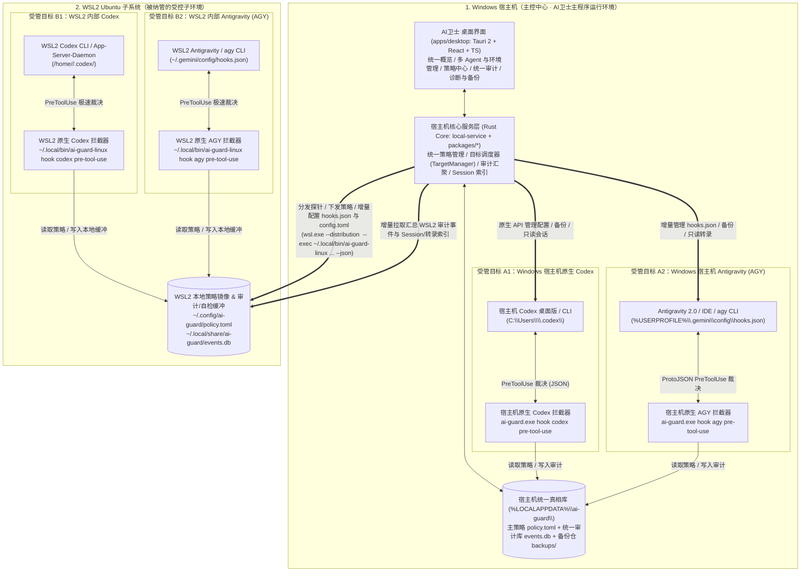
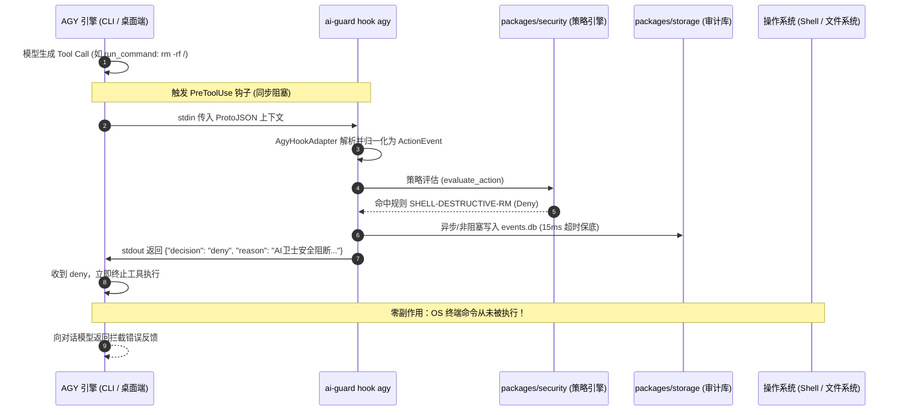

# AI卫士（AI Guard）系统架构设计

## 1. 架构设计目标与原则

AI卫士是一款**运行在 Windows 宿主机上的原生桌面安全管理平台**，采用**“Windows 宿主机中心化主控 + 宿主机/WSL2 双环境就地拦截（Host-Centric Control + In-Place Hook Enforcement）”**的模块化单体架构（基于 Rust Cargo Workspace）。

### 核心架构原则

1. **宿主机中心化主控（Windows Host as Master Control Plane）**：
   - 产品的最终交付形态是运行在 Windows 宿主机上的桌面软件（`AI卫士.exe`）。
   - 全局安全策略真源（`policy.toml`）、统一安全审计与状态数据库（`events.db`）、统一备份保险箱（`backups/`）均由 **Windows 宿主机主控端** 统一管理（存储于宿主机 `%LOCALAPPDATA%\ai-guard\`）。
   - 即使未安装或未启动 WSL2，宿主机主程序依然可完全独立工作，正常纳管宿主机本机的 Codex 桌面版与 CLI。
2. **宿主机与 WSL2 双环境统一纳管（Dual-Environment Governance）**：
   - **环境一（Windows 宿主机原生 Codex）**：直接纳管宿主机 `C:\Users\<User>\.codex\`（含 Codex 桌面版及 Windows CLI / `codex-command-runner.exe`）。
   - **环境二（WSL2 子系统内 Codex）**：跨边界纳管 WSL2 发行版（如 Ubuntu）内的 `/home/<user>/.codex/`（含 WSL2 `codex-cli` 及 `app-server-daemon`）。
3. **控制面集中管理、数据面（Hook 拦截）就地极速执行**：
   - 安全拦截热路径（`PreToolUse` Hook）必须遵循**“Codex 在哪个 OS 内核执行工具，就调用哪个 OS 原生编译的 Hook 二进制”**原则：
     - 宿主机 Codex 触发同在宿主机上的 `ai-guard.exe hook`；
     - WSL2 内 Codex 触发由宿主机主控自动分发部署到 WSL2 内的 Linux 原生 `ai-guard-linux hook`（读取宿主机同步过去的本地策略镜像），从而彻底避免每次工具调用跨 Windows/WSL2 虚拟机边界拉起进程带来的数百毫秒冷启动延迟与引号丢失风险。
4. **严格分层与单向依赖**：
   - 前端 React WebView 界面仅通过 Tauri Rust Commands 访问宿主机核心服务，不直接操作底层文件或拼接 Shell 命令。
5. **诚实安全边界与 Fail-Closed**：
   - 在已进入 Rust Hook 进程且能返回合法协议的范围内，任何解析失败、策略损坏或未知输入均显式返回 `permissionDecision = "deny"`（Fail-Closed）。
   - 严格区分 `Observe（观察）`、`Hook Deny（协议层拒绝）` 与 `Sandbox Enforcement（内核强制隔离）`，按被纳管的每个环境独立计算并展示四态防护状态（`protected_verified` / `partially_protected` / `unprotected` / `unknown`）。
6. **只读优先与先备后改**：
   - 对宿主机与 WSL2 内的 Codex 会话数据（`session_index.jsonl`、`thread_history_1.sqlite`、`state_5.sqlite`）与 AGY 转录（`transcript.jsonl`）坚持只读访问；
   - 任何修改宿主机或 WSL2 Codex / AGY 配置、清理会话的操作，强制前置调用 `packages/backup` 完成快照备份与 SHA-256 完整性校验。
7. **多 Agent 协议解耦与统一策略内核（Multi-Agent Protocol Decoupling）**：
   - 适配层（`packages/agent-adapters`）将不同 Agent 的特定通信协议（Codex 的 `PreToolUse` hookSpecificOutput 与 AGY 的 ProtoJSON decision）归一化为标准的 `ActionEvent`；
   - 核心安全引擎（`packages/security`）与统一审计库（`packages/storage`）保持 100% Agent 无关，实现一套规则引擎同时保护 Codex 与 AGY。

---

## 2. 系统总体架构图（宿主机主控 + 双 Agent 协同）



---

## 3. 核心模块职责与同源跨平台构建

工程采用 **Rust Cargo Workspace** 组织，同一套核心代码同时编译出两个平台的产物：
- **Windows 宿主机产物**：`ai-guard-desktop.exe`（Tauri 桌面主程序）与 `ai-guard.exe`（宿主机 CLI 及宿主机 Hook Runner）。
- **WSL2 Linux 探针产物**：`ai-guard-linux`（静态链接的 Linux CLI 及 WSL2 内部 Hook Runner，由宿主机主程序随包内置并自动部署到 WSL2 中）。

| 模块路径 | 核心职责 | 跨环境（Host + WSL2）运行角色 |
| :--- | :--- | :--- |
| `apps/desktop` | 运行于 Windows 宿主机的全中文桌面界面，提供统一安全概览、宿主机与 WSL2 双目标切换/聚合视图、策略编辑、审计检索、配置 Diff 确认与 Session 备份管理。 | **仅在 Windows 宿主机运行**，作为用户唯一交互入口。 |
| `apps/local-service` | 提供统一的 CLI 与服务协调器：在宿主机侧作为主控调度器（管理本机目标并通过 `wsl.exe --exec` 调度 WSL2 目标）；在两边环境内同时承担 `hook codex pre-tool-use` 与 `hook agy pre-tool-use` 极速入口，并提供 `install codex` / `install agy` 事务安装器。 | 同源编译为宿主机 `ai-guard.exe` 与 WSL2 `ai-guard-linux`。 |
| `packages/agent-adapters` | 封装 Codex 与 Antigravity（AGY 桌面版、IDE 与 `agy` CLI）的多 Agent 适配层：多环境配置发现（`.codex` 与 `.gemini/config/hooks.json`）、Hook 协议解析（Codex JSON 与 AGY ProtoJSON）、工具名归一化（`run_command`、`write_file`、`edit_file`、`call_mcp_tool`）及 Fail-Closed 决策输出。 | 双端共用（含 Windows 与 WSL2 路径/进程探测实现）。 |
| `packages/security` | 纯确定性安全策略引擎：TOML 规则编译校验、同时覆盖 POSIX Shell（`bash`/`sh`）与 Windows Shell（`powershell`/`pwsh`/`cmd`）的高危命令分析、跨平台敏感路径保护、Deny 优先裁决。 | 双端共用，100% 平台无关纯逻辑。 |
| `packages/backup` | 通用快照备份与 SHA-256 校验引擎：在修改宿主机与 WSL2 的 Codex / AGY 配置文件及清理 Session 前，生成带 SHA-256 的 `manifest.json` 并支持原子恢复。 | 双端共用（内部通过 `#[cfg(windows)]` 与 `#[cfg(unix)]` 封装原子替换与权限）。 |
| `packages/storage` | 管理 SQLite（WAL 模式 + 15ms 超时无锁 `events-fallback.jsonl`）、敏感信息脱敏器（Redactor）以及 WSL2 审计事件向宿主机主库的增量同步归并。 | 宿主机作为主库（Master DB），WSL2 作为本地缓冲库（Edge Buffer）。 |
| `packages/session` | 承接会话只读治理：以严格只读方式（`SQLITE_OPEN_READ_ONLY`）扫描 Codex（`session_index.jsonl`、SQLite）与 AGY（`transcript.jsonl`、`brain/` 工件），在宿主机桌面端统一呈现并支持一键安全备份。 | 双端共用，宿主机汇总展示。 |

---

## 4. 关键跨环境协同机制设计

### 4.1 宿主机主程序如何纳管两套 Codex 环境？

系统在领域层定义 `ManagedEnvironment`（受管环境实例）：

```rust
pub enum EnvironmentKind {
    WindowsHost,
    Wsl2Distro { distro_name: String },
}

pub enum ClientSurface {
    CodexDesktopApp,
    CodexCli,
    CodexAppServerDaemon,
    AgyCli,
    AgyDesktopApp,
    AgyIde,
}

pub enum AgentKind {
    Codex,
    Antigravity,
}

pub struct ManagedTarget {
    pub target_id: String,               // 如 "win-host-codex" 或 "wsl2-Ubuntu-agy"
    pub agent_kind: AgentKind,
    pub env_kind: EnvironmentKind,
    pub detected_surfaces: Vec<ClientSurface>,
    pub agent_home: String,              // 如 "C:\Users\kui.li\.codex" 或 "/home/ai-li/.gemini"
    pub agent_version: Option<String>,
    pub protection_status: CoverageStatus, // protected_verified / partially_protected / unprotected / unknown
}
```

1. **对宿主机原生 Codex（`win-host-default`）的管理链路**：
   - **发现**：直接检测 `%USERPROFILE%\.codex`（如 `C:\Users\kui.li\.codex`）、宿主机 Codex 桌面版进程及 `.sandbox-bin\codex.exe` 版本。
   - **安装与备份**：直接调用宿主机 `packages/backup` 备份 `C:\Users\<User>\.codex\config.toml` / `hooks.json`，写入指向宿主机 `ai-guard.exe` 绝对路径的 Hook 配置（针对 Windows Shell 命令行引号做安全编码）。
   - **拦截与审计**：宿主机 Codex 触发 `ai-guard.exe hook codex pre-tool-use`，直接读取 `%LOCALAPPDATA%\ai-guard\policy.toml` 并将脱敏事件写入宿主机 `%LOCALAPPDATA%\ai-guard\events.db`。
2. **对 WSL2 子系统 Codex（`wsl2-<distro>`）的管理链路**：
   - **发现**：宿主机主程序通过 `wsl.exe --list --quiet` 枚举已安装发行版，并通过受控命令探测各发行版内的 `~/.codex` 与 `codex` 版本。
   - **探针部署与策略镜像同步**：
     - 启用某 WSL2 发行版保护时，宿主机主程序自动将内置的同版本 `ai-guard-linux` 二进制校验并安装至该 WSL2 的 `~/.local/bin/ai-guard-linux`；
     - 每次宿主机主策略 `policy.toml` 更新时，宿主机主程序自动将其同步写入 WSL2 的 `~/.config/ai-guard/policy.toml`（带 SHA-256 校验）。
   - **就地拦截与事件汇总**：
     - WSL2 内 Codex 触发 `~/.local/bin/ai-guard-linux hook codex pre-tool-use`，在 Linux 命名空间内毫秒级完成裁决并写入 WSL2 本地缓冲库；
     - 宿主机桌面端打开或定时刷新时，通过受控白名单命令 `wsl.exe --distribution <distro> --exec ~/.local/bin/ai-guard-linux events pull --since <cursor> --json` 将 WSL2 事件增量归并到宿主机 `events.db` 统一展示（严禁跨 `\\wsl.localhost\` 9P 网络文件系统直接并发读写 SQLite 数据库文件）。

### 4.2 研发环境（WSL2 内 AGY 开发）与目标运行环境（Windows 宿主机运行）的衔接

由于当前使用 AGY 在 WSL2 Ubuntu（`/home/ai-li/codes/ai-guard`）内进行研发，工程构建与测试按以下方式组织：
1. **第一阶段（核心逻辑与双端 CLI 验证）**：
   - 在 WSL2 内编写跨平台 Rust 核心库（`packages/*`）与 `apps/local-service`；
   - 编译 Linux 产物验证 WSL2 Codex 拦截闭环，同时通过交叉编译或调用宿主机 Windows Rust 工具链编译 `ai-guard.exe`，针对宿主机临时测试目录验证 Windows 原生 Codex 拦截闭环。
2. **第二阶段（宿主机 Tauri 桌面端联调）**：
   - 编译运行 Windows 宿主机的 `apps/desktop`（Tauri 2），在宿主机上同时联调对 `win-host-default`（本机直连）与 `wsl2-Ubuntu`（`wsl.exe --exec` 桥接）的双环境纳管。

### 4.3 Antigravity（AGY）与 agy CLI 原生 Hook 管控架构设计

#### 4.3.1 配置与挂载体系（Hierarchical Hooks）
AGY 采用原生 Draft-07 ProtoJSON 规范的 `hooks.json` 配置进行扩展注入。AI卫士采用命名空间隔离方式无损挂接：
- **全局生效**：Linux/WSL2 为 `~/.gemini/config/hooks.json`；Windows 宿主机为 `%USERPROFILE%\.gemini\config\hooks.json`。
- **项目级覆盖**：`<workspace>/.agents/hooks.json`。
- **配置结构**：
  ```json
  {
    "ai-guard": {
      "enabled": true,
      "PreToolUse": [
        {
          "matcher": "run_command|write_file|edit_file|call_mcp_tool",
          "hooks": [
            {
              "type": "command",
              "command": "ai-guard hook agy pre-tool-use",
              "timeout": 5
            }
          ]
        }
      ]
    }
  }
  ```
- **事务与无损保证**：修改前通过 `packages/backup` 创建含 SHA-256 的快照；卸载时仅剔除 `"ai-guard"` 节点，彻底杜绝破坏用户自定义的其他 hooks。

#### 4.3.2 适配器归一化与 Wire 协议
`packages/agent-adapters` 中的 `AgyHookAdapter` 负责标准 I/O 协议转换：
1. **标准输入解析（stdin）**：
   - 读取上限 2 MiB，严格解析 ProtoJSON；
   - 提取 `toolCall.name` 与参数：将 `run_command.args.CommandLine` 映射为终端命令；将 `write_file`/`edit_file` 的 `Path` 与 `Content` 映射为写文件事件；将 `call_mcp_tool` 映射为 MCP 调用。
2. **策略判定与通用复用**：
   - 将转换后的 `ActionEvent` 提交给统一的 `packages/security` 策略引擎进行快速纯内存匹配（耗时 < 2ms），无需为 AGY 重写高危命令、敏感路径等规则。
3. **标准输出序列化（stdout）**：
   - 放行：`{"decision": "allow"}`；
   - 阻断：`{"decision": "deny", "reason": "..."}`；
   - 人机确认：`{"decision": "ask", "reason": "..."}`。

#### 4.3.3 AGY 工具调用拦截全生命周期时序图



#### 4.3.4 Fail-Closed 与保底防御机制
1. **异常必阻断**：若 stdin 输入超长、格式破损或进程内部异常，默认返回 `{"decision": "deny"}`，绝不发生 Fail-Open；
2. **审计脱敏与日志保护**：返回的 `reason` 和写入库的审计字段强制进行密钥脱敏（`redact_secrets`），防止 Token、密码泄露；
3. **超时与孤儿进程防护**：Hook 单次执行严格限制超时，审计落库失败降级为内存/fallback 记录，不拖慢交互。

#### 4.3.5 转录流与工件治理
1. **转录解析（`transcript.jsonl`）**：严格以只读流式解析 AGY 的 `transcript.jsonl`，提取会话概要、交互步骤、耗时与工具调用流水；
2. **工件扫描（`brain/`）**：扫描关联的生成工件（报告、UI 预览、代码片段）；
3. **快照备份与验签**：调用 `packages/backup` 对会话全量数据进行 tar/zst 压缩打包并记录 SHA-256，支持在桌面端一键核验与导出。
